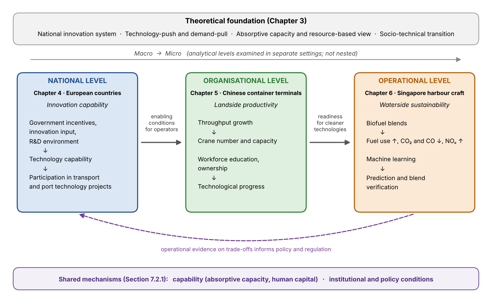

> *Notes to you are in grey italic boxes like this one. Everything else is proposed thesis text, to be marked purple. Insert the new tables and the figure with Word's Insert Caption so the numbering of later tables and figures updates automatically.*

# PART A — CHAPTER 1 REVISIONS

## A1. Section 1.2 Research objectives: replace the opening paragraph

> *Replaces the paragraph beginning "The overall objective of this thesis is to investigate…". Also correct Objective 4 to "Study 4 (Chapter 6)".*

The overall objective of this thesis is to investigate how technological development in transport infrastructure, with a focus on ports, relates to innovation capability, operational productivity and sustainability at the national, organisational and operational levels. Because the factors that explain technology advancement differ from one level of analysis to another, each empirical study is conducted in the setting where the relevant variation can be observed and comparable data are available. The national-level study draws on European countries (Chapter 4), the organisational-level study on Chinese container terminal operators (Chapter 5), and the operational-level study on harbour craft in the Port of Singapore (Chapter 6). The thesis therefore adopts a multi-level, multi-context design. Within the broad field of port technology advancement, the thesis examines each of these aspects in depth rather than testing the interconnections between them, which are left for future research (Section 7.4). Rather than estimating a single pooled model across the three settings, it connects the studies through the theoretical mechanisms they share and through an explicit assessment of how country-specific factors condition the findings (Section 7.2). The rationale for the choice of each setting is set out in Section 1.4. To achieve this aim, the research is structured around the following specific objectives:

## A2. New Section 1.4 Rationale for the empirical contexts

> *Insert after Section 1.3. The current Sections 1.4–1.6 become 1.5–1.7.*

**1.4 Rationale for the empirical contexts**

The three empirical studies in this thesis are deliberately situated in different contexts. The selection follows the logic of purposive, information-oriented case selection, in which a setting is chosen because it offers the variation and data required to answer a particular research question rather than because it is statistically representative of all ports (Flyvbjerg, 2006; Seawright & Gerring, 2008). In multi-level research, the relevant source of variation differs between levels (Kozlowski & Klein, 2000). National-level determinants, such as government incentives for research and development (R&D), can be estimated only from differences between countries. Organisational-level dynamics, such as equipment deployment and the effect of ownership, are best identified by comparing many organisations that operate under the same national institutional regime. Operational-level performance, in turn, requires high-frequency data from a technology that is actually being deployed. As no single country satisfies all three conditions, each study is located in the setting that best meets the requirements of its level of analysis (Table [new-1]).

At the national level, Chapter 4 requires cross-national variation in government incentives, innovation input and the technology development level, measured on a comparable basis. European countries meet this requirement for three reasons. First, the data are harmonised. Project-level information is drawn from the European Commission's Transport Research and Innovation Monitoring and Information System (TRIMIS), which records transport research and innovation projects under common reporting conventions (European Commission, 2023b), while national R&D indicators follow the definitions of the Frascati Manual (OECD, 2015). Second, the countries share a broadly common policy framework: most projects in the sample are funded by the European Commission or by European national governments under common programme rules, and most of the countries belong to the Continental European port doctrine, in which ports are regarded as part of wider public infrastructure (Lee & Flynn, 2011). Third, considerable variation exists within this common framework. National innovation systems in Europe remain diverse (Kaiser & Prange, 2004), and the European Innovation Scoreboard distinguishes innovation leaders, concentrated in Northern and Western Europe, from moderate and emerging innovators, many of which are in Southern and Eastern Europe (European Commission, 2024). The combination of comparable measurement and substantial differences in innovation capability and public support makes European countries an appropriate setting for testing the hypothesised national-level relationships, which a single-country design, with national policy held essentially constant, could not identify.

At the organisational level, Chapter 5 requires a large panel of container terminals that differ in equipment, workforce and ownership while operating under the same national governance framework, so that organisational effects are not confounded with differences between national systems. China provides such a setting. It has the largest container port throughput of any country (UNCTAD, 2025) and has invested heavily in port equipment and automation; by late 2024, the Ministry of Transport reported 52 fully automated terminals, the largest number of any country (Xinhua, 2025). The growth in throughput and equipment during the study period therefore offers the variation needed to model how equipment deployment responds to throughput over time. At the same time, Chinese ports have developed along a common governance path since the Port Law of 2004, which decentralised port administration to municipal governments and opened the sector to mixed and foreign investment within a framework of national policy guidance (Notteboom & Yang, 2017). This produces a population of terminal operators with state, mixed and private ownership under a single national regime, which is the variation required to examine the relationship between ownership and technological progress. In addition, the China Ports Yearbook reports equipment, workforce and throughput data for individual operators on a consistent basis over time. Terminals from the wider Asian region were not pooled, because Asian port systems differ markedly in governance, development stage and logistics capability. The Logistics Performance Index 2023, for instance, scores Singapore at 4.3 and China at 3.7, but Cambodia and Lao PDR at 2.4 (World Bank, 2023), and the efficiency and market concentration of Southeast Asian container ports vary considerably (Nguyen et al., 2020). Combining such systems would confound terminal-level effects with country-level differences that the available data cannot control.

At the operational level, Chapter 6 requires high-resolution operating data on a sustainable technology that is being adopted in practice under real policy pressure. Singapore is well suited to this purpose. It is the world's largest bunkering port, with record bunker sales of 56.77 million tonnes in 2025, of which 1.36 million tonnes were biofuel blends (MPA Singapore, 2026a, 2026b). Its decarbonisation policy also targets the vessel type examined: under the Maritime Singapore Decarbonisation Blueprint (MPA Singapore, 2022), all new harbour craft operating in the port from 2030 must be fully electric, capable of using B100 biofuel, or compatible with net-zero fuels (MPA Singapore, 2024b). Singapore has also introduced a provisional national quality standard for marine biofuel, together with conditions for its supply by licensed bunker suppliers (Argus Media, 2022). More broadly, it has been ranked the leading international shipping centre in every edition of the Xinhua–Baltic International Shipping Centre Development Index since 2014 (MPA Singapore, 2026b), and its port authority employs a wide range of green port management tools compared with other leading ports in Asia and Europe (Lam & Notteboom, 2014). Because biofuel trials on harbour craft were conducted in this setting, the study was able to use sensor data from actual sea trials rather than laboratory or simulated data.

This design has an important implication for interpretation. The three settings differ in governance, ownership, labour arrangements, technological maturity, environmental regulation and data availability. Accordingly, the thesis regards its analytical frameworks as transferable, but its estimated coefficients and operational results as specific to the context in which they were obtained; they should not be applied to other ports without recalibration. Section 7.2 draws the findings together through the mechanisms they share, considers how country-specific factors condition them, and discusses when and how a result obtained in one setting may or may not be applied in another.

**Table [new-1]: Empirical contexts of the three studies**

| Study | Level | Context | Main reason for selection |
|---|---|---|---|
| Chapter 4 | National | European countries | Comparable cross-national data; varied innovation capability within a common framework |
| Chapter 5 | Organisational | Chinese container terminal operators | Large, growing terminal system; varied ownership under one governance regime |
| Chapter 6 | Operational | Harbour craft, Port of Singapore | Leading bunkering hub; biofuel in use under a 2030 harbour craft mandate |

## A3. Section 1.5 (now 1.6) Research significance: replace the final paragraph

Overall, the significance of this research lies in its multi-level analytical perspective. Rather than examining technology advancement from a single angle, the thesis combines a theoretical review of port technology development (Chapter 3) with three empirical studies: a national-level analysis of factors associated with participation in technology projects in European countries (Chapter 4), an organisational-level evaluation of equipment deployment and technological progress in Chinese container terminals (Chapter 5), and an operational-level assessment of biofuel adoption in Singapore's harbour craft using machine learning (Chapter 6). Since the empirical studies are set in different contexts, they are not combined into a single estimated model. Instead, they are integrated through the implications that each level carries for the others, through three mechanisms that recur across them, namely technological capability, human capital, and institutional and policy conditions, and through an explicit discussion of how country-specific factors shape the transferability of the findings (Section 7.2). This approach advances academic understanding while offering stakeholders practical, context-sensitive guidance on port technology development in an era of global trade and decarbonisation.

## A4. Section 1.6 (now 1.7) Thesis structure: replace the Chapter 7 description

Chapter 7 concludes the thesis by summarising the main findings, presenting a cross-study synthesis of how the findings are connected and how country-specific factors condition their transferability, highlighting the theoretical and practical contributions, and outlining limitations and directions for future research.

# PART B — NEW SECTION 7.2

> *Insert after Section 7.1. The current 7.2 becomes 7.3 and the current 7.3 becomes 7.4.*

## 7.2 Cross-study synthesis and the role of context

Technology advancement in ports is a broad field that comprises many specific aspects, such as innovation and investment, automation and cargo-handling equipment, digitalisation, productivity and environmental sustainability. Port development frameworks such as the sixth-generation port concept treat these as related dimensions of a single process of port transformation (Lee et al., 2025), yet, as the review in Chapter 3 showed, they have largely been studied separately, and a systematic framework for understanding port technology development is still lacking. This thesis brings several of these aspects together within one research design, but it examines each in depth within its own study: innovation capability at the national level (Chapter 4), equipment deployment and technological progress at the organisational level (Chapter 5), and sustainable operations at the operational level (Chapter 6). The interconnections between these aspects were not tested empirically, as this would require data that link national innovation conditions, terminal equipment and vessel operations for the same port system, which were not available for this research. The in-depth study of each aspect is nonetheless a necessary step. Each aspect has its own unit of analysis, data requirements and appropriate methods, and a reliable integrated model can be built only once the constructs, measures and relationships within each aspect have been established. The frameworks and findings of the three studies therefore provide building blocks for a future empirical synthesis (Section 7.4).

For the same reason, the results of the three studies cannot be combined in a single estimated model, and the coefficients reported in each chapter apply only to the setting in which they were estimated. The findings can nevertheless be integrated at the stage of interpretation, by examining how they relate to one another and what they jointly imply (Fetters et al., 2013). This section first sets out how the studies are linked and the mechanisms they share (Section 7.2.1). It then examines the country-specific factors that underlie the findings (Section 7.2.2), and finally discusses the extent to which the findings can be transferred to other contexts (Section 7.2.3).

> *Section 7.4 (future research) should include a matching sentence when we revise it, for example: "Future research could examine the interconnections between the aspects studied in this thesis directly, by assembling linked data for a single port system that combine national or regional innovation conditions, terminal equipment and productivity, and vessel-level energy and emissions, and by estimating multi-level models that test the cross-level implications proposed in Section 7.2.1."*

### 7.2.1 Synthesis of the studies and shared mechanisms

Figure [new-1] summarises how the three empirical studies are linked within the theoretical foundation established in Chapter 3.

**Figure [new-1]: Synthesis of the empirical studies**

*Note:* Each box represents a separate empirical setting. Arrows within a box show relationships estimated in the corresponding chapter. Arrows between boxes show conceptual implications drawn from the findings; they were not estimated.

The three studies follow technology advancement from its development to its deployment and its sustainable use. At the national level, Chapter 4 shows that government incentives and innovation input are associated with a higher national technology development level, which is in turn associated with greater participation in transport and port technology projects. These results describe the enabling conditions, namely public funding, knowledge resources and a supportive R&D environment, under which port organisations decide whether to invest in new technologies. At the organisational level, Chapter 5 examines how technology is embodied in landside cargo-handling equipment and translated into productivity: crane number and capacity follow throughput growth, and technological progress is associated with workforce education and with greater private participation in ownership. At the operational level, Chapter 6 turns to the waterside, where the question is no longer how much technology is deployed but whether its use is sustainable: biofuel blends reduce CO₂ and CO emissions but increase NOₓ emissions and fuel consumption, and machine-learning models make these effects measurable. Each level therefore carries implications for the next. The national technology development level and incentives shape the knowledge and resources available to terminal operators; operators' investment and workforce decisions determine their readiness to adopt new technologies, including cleaner energy; and operational evidence on sustainability trade-offs indicates where national policy and port regulation may need to intervene, for example through complementary NOₓ control. Although the levels run from macro to micro, they are not nested within one another, because each is examined in a different setting: the Chinese terminals are not part of the European sample, and the Singapore harbour craft are not part of the Chinese terminal system. The levels are therefore analytical rather than hierarchical, and the links between them are conceptual implications rather than estimated cross-level effects. The level distinction is complemented by a functional one. Chapter 5 addresses landside cargo handling, where productivity is the main objective, and Chapter 6 addresses waterside port services, where emissions are the main concern. Together they cover the two main operating domains of a port.

Beyond this sequence, three mechanisms recur across the studies and help to explain why the findings take the form they do. The first is technological capability. Absorptive capacity theory holds that the benefit an organisation or a country obtains from external technology depends on its prior knowledge and its ability to recognise, assimilate and apply new knowledge (Cohen & Levinthal, 1990). In Chapter 4, the national technology development level, which reflects what national capabilities have achieved, mediates the effects of government incentives and innovation input on participation, so that public support is associated with participation mainly through the technological development it supports. In Chapter 5, allowing terminal-specific intercepts and slopes improves the fit of the growth models, which shows that terminals operating under the same national regime differ in their technology levels and rates of technological progress, consistent with differences in organisational capability. In Chapter 6, the models show that onboard data can be used to predict fuel consumption and emissions and to identify blending ratios accurately, which is the analytical capability that operators and regulators need in order to adopt biofuel on the basis of evidence. Technology advancement therefore depends not only on access to technology but also on the capability to make use of it.

The second mechanism is human capital. Human capital theory holds that education and skills raise the capacity to adopt and implement new technologies, so that the pace of technology diffusion depends on the educational level of the workforce (Benhabib & Spiegel, 1994; Nelson & Phelps, 1966). From the resource-based perspective reviewed in Chapter 3, skilled people are also an organisational resource that complements physical equipment (Section 3.4.2). This mechanism appears at each level, although it is measured differently. In Chapter 4, researchers in the civil and transport sectors are part of national innovation input, and higher-education researchers are part of technological innovation capacity in the port case, so the human resources devoted to research are embedded in the capability associated with participation. In Chapter 5, terminals with a higher share of employees holding a bachelor's degree or above show higher technological progress, which is the most direct evidence of this mechanism in the thesis. Chapter 6 does not measure human capital, but its implications depend on it. The machine-learning models are decision-support tools whose value relies on staff able to collect, interpret and act on operational data, and Singapore's transition to new marine fuels involves crew training alongside infrastructure, regulations and safety standards (MPA Singapore, 2024b). Technology advancement in ports therefore requires investment in people as well as in equipment and systems.

The third mechanism is the influence of institutional and policy conditions. National innovation system theory holds that technological change is shaped by the institutions and policies within which organisations operate (OECD, 2002). In Chapter 4, government R&D incentives and a favourable R&D environment, reflected in legal structure, property rights and academic freedom, are associated with stronger technological capacity. In Chapter 5, ownership structure, itself a product of port governance reform (Notteboom & Yang, 2017), is associated with the rate of technological progress. Chapter 6 does not model policy directly, but the technology it examines is adopted largely in response to regulation, in particular Singapore's requirements for new harbour craft from 2030 (MPA Singapore, 2024b), and its results bear directly on regulatory design. Because institutional and policy conditions differ markedly between countries, this mechanism is also the main reason why the findings are context-specific, as discussed in the next section.

### 7.2.2 Country-specific factors and heterogeneity

Each empirical setting was selected because it provides the variation and data that the corresponding level of analysis requires (Section 1.4). This section briefly restates the reason for each choice and explains how the characteristics of each setting help to account for the findings and shape their implications. Table [new-2] summarises the main differences between the three settings.

European countries were selected for the national-level study because they combine harmonised cross-national data with substantial differences in innovation performance within a broadly common policy framework (European Commission, 2024; Kaiser & Prange, 2004; OECD, 2015). These characteristics also help to explain the findings. Most of the projects examined in Chapter 4 are funded by the European Commission or by European national governments, and taking part in them is a decision of the organisations concerned. In such a setting, government incentives would be expected to work indirectly, by supporting the technological development that makes participation feasible, which is consistent with the mediating role of the technology development level found in Chapter 4. The importance of the R&D environment in the port case likewise reflects institutional conditions, such as the security of property rights and academic freedom, which differ across the countries in the sample. The Continental European port doctrine, under which public investment in ports is justified by wider economic and social benefits (Lee & Flynn, 2011), offers a further reason why public support is closely associated with participation. For European policymakers, the implication is that raising the national technology development level is likely to be more effective than funding individual projects alone. The results also apply most directly to countries with comparable institutional quality.

China was selected for the organisational-level study because it offers a large and growing population of container terminals with varied ownership under a single national governance regime, together with consistent terminal-level data (Notteboom & Yang, 2017; UNCTAD, 2025). Its characteristics are closely reflected in the results. The study period was one of rapid throughput growth and large-scale investment in equipment and automation; by late 2024, China had 52 fully automated terminals, more than any other country (Xinhua, 2025). In a growing market of this kind, operators expand crane numbers and capacity in response to throughput, which is the pattern observed in Chapter 5. The reforms that followed the Port Law of 2004 decentralised port administration and opened the sector to mixed and foreign investment (Notteboom & Yang, 2017). This created the variation in ownership that made it possible to observe the association between greater private participation and faster technological progress. China is distinctive in combining scale, rapid growth and ownership diversity under strong state guidance, and the implications are correspondingly specific. For Chinese terminal operators, the evidence supports planning equipment against expected throughput, investing in workforce education and continuing mixed-ownership reform. In countries with mature markets or different ownership arrangements, the same relationships may be weaker or take a different form.

Singapore was selected for the operational-level study because it combines an established biofuel supply chain, a decarbonisation policy aimed specifically at harbour craft and access to real sea-trial data. As the world's largest bunkering port, Singapore supplied 1.36 million tonnes of biofuel blends in 2025 (MPA Singapore, 2026a, 2026b), which provides the supply base for operational trials with high biofuel blends. The requirement that all new harbour craft from 2030 be fully electric, B100-capable or compatible with net-zero fuels (MPA Singapore, 2024b) makes the results for B100 directly relevant to policy. The harbour craft fleet of about 1,600 vessels (MPA Singapore, 2023) gives the findings practical scale. The conditions that MPA has set for biofuel supply, including measurement requirements for licensed bunker suppliers (Argus Media, 2022), also explain the practical value of the blending-ratio classification developed in Chapter 6 as a verification tool. Because a single national authority sets port-specific requirements, the CO₂–NOₓ trade-off identified in the chapter can be addressed directly through port regulation, for instance by combining biofuel use with NOₓ abatement or monitoring. At the same time, the results reflect Singapore's tropical operating conditions, its vessel and engine types, and a single biofuel, used cooking oil methyl ester. These factors limit their direct application elsewhere.

**Table [new-2]: Heterogeneity of the three study settings**

| Dimension | European countries (Ch. 4) | China (Ch. 5) | Singapore (Ch. 6) |
|---|---|---|---|
| Level and port domain | National; transport and port infrastructure | Organisational; landside terminals | Operational; waterside harbour craft |
| Port doctrine | Continental European | Asian | Asian |
| Governance | Landlord port authorities | Municipal, under national guidance | Regulator (MPA) separate from operator (PSA) |
| Ownership | Private operators under concessions | Mainly state-owned; some mixed and foreign | State-owned operator (PSA) |
| Labour and workforce | Diverse dock-labour regimes | Workforce education varies across operators | Union–operator cooperation on reskilling |
| Technological maturity | Wide variation across countries | Largest number of automated terminals | High innovation ranking |
| Environmental regulation | Supranational EU instruments | Government-led | Port-specific mandates and standards |
| Data used | Harmonised national statistics | Terminal-level yearbook data | Onboard sensor data |

*Sources:* Lee and Flynn (2011); World Bank (2025); Notteboom and Yang (2017); National Library Board Singapore (2005); Turnbull and Wass (2007); PSA Singapore (2022); European Commission (2024); Xinhua (2025); WIPO (2024); Lam and Notteboom (2014); European Parliament and Council of the European Union (2023); MPA Singapore (2024b); Chapter 5 data.

> *The labour row now uses sourced entries: Turnbull & Wass (2007) for Europe; your own Chapter 5 data for China; and PSA's Tuas Port release (PSA Singapore, 2022), which says staff were retrained with the Singapore Port Workers Union and the Port Officers' Union, for Singapore.*

Taken together, the three settings differ in governance, ownership, labour arrangements, technological maturity, environmental regulation and data availability, and each set of findings reflects a particular combination of these conditions. This heterogeneity is what allows each relationship to be observed where it is most evident. It also determines how far the findings can be transferred, which is discussed in the next section.

### 7.2.3 Transferability of the findings

The transferability of the findings has already been considered in each empirical chapter. Chapter 4 noted that its results derive mainly from developed European countries with strong national innovation systems, stable governance and clear regulatory frameworks. They are therefore most directly applicable to similarly developed contexts (Section 4.4.3). Chapter 5 concluded that the growth model is validated for the studied terminals but is not universally transferable. Applying it to other ports would require redefining the time structure, adapting the variables to local terminal characteristics, recalculating the productivity indicators and re-estimating the model with local panel data (Section 5.6). Chapter 6 likewise concluded that the machine-learning models are reliable as decision-support tools for the studied case, but that wider use would require recalibration with data from other vessels, routes, operating profiles, fuels and regulatory environments (Section 6.5). This section brings these assessments together and states more explicitly when, and how, a success or an issue identified in one setting can or cannot be applied to another.

Whether a result obtained in one setting will hold in another depends on whether the conditions that supported it are also present in the new setting (Cartwright & Hardie, 2012). Policy lessons are usually transferred through adaptation rather than direct copying (Dolowitz & Marsh, 2000). Accordingly, the thesis distinguishes three degrees of transferability. The analytical frameworks, methods and measurement approaches are transferable and can be applied in other contexts. The direction of the relationships is conditionally transferable: it can be expected to hold where the supporting conditions are present, but should be re-tested where they are not. The estimated coefficients, intercepts and trained model parameters are not transferable and must be re-estimated with local data before use. Table [new-3] applies this classification to the main findings.

**Table [new-3]: Transferability of the main findings**

| Finding | Transferable | Conditionally transferable | Requires recalibration |
|---|---|---|---|
| Incentives → development level → participation (Ch. 4) | SEM framework and constructs | Where institutions are stable and participation is incentive-driven | Path coefficients |
| Throughput → crane deployment (Ch. 5) | Growth-model approach | In growing, demand-led port markets | Intercepts and growth slopes |
| Education and ownership → technological progress (Ch. 5) | MPI decomposition | Education: widely; ownership: depends on governance | Effect sizes; ownership coding |
| Biofuel: lower CO₂ and CO, higher NOₓ (Ch. 6) | ML workflow and features | Similar engines, fuels and duty cycles | Magnitudes; trained models |

Transferability is limited not only by context but also by the nature of technology itself. As discussed in Sections 2.1.2 and 2.4, technology is heterogeneous and is usually embodied in machines and equipment. Each study therefore measures technology in a form suited to its level: national indicators of the technology development level in Chapter 4, the number and capacity of cranes together with the Malmquist frontier shift in Chapter 5, and the performance of fuel blends in a given engine in Chapter 6. The findings refer to these specific forms of technology and should not be generalised to technology as a whole. The Chapter 5 results concern cargo-handling cranes in container terminals and may not hold for digital systems, and the Chapter 6 results concern biodiesel blends in high-speed diesel engines and may differ for other engine types (Chountalas et al., 2023).

The European finding that incentives work largely by raising the technology development level is most likely to be repeated in economies with strong innovation systems and voluntary, project-based participation in technology development, such as advanced Asian economies. Where governments plan and finance port technology directly, as is common under the Asian port doctrine (Lee & Flynn, 2011), participation may be driven by state programmes rather than by technological development built through incentives. The mediating role of the development level may then be weaker. In such settings, the European result should inform the design of policy rather than be copied directly (Dolowitz & Marsh, 2000).

In China, the close link between throughput and crane deployment reflects a growth phase in which capacity expansion is the main motive for investment. In mature European ports, or in land-constrained ports such as Singapore, equipment decisions are more likely to be driven by vessel size, automation and the efficient use of scarce land, and they depend on terminal-specific characteristics (Knatz et al., 2022). The principle of planning equipment against expected throughput, supported by workforce education, can be transferred; the estimated growth rates cannot. The ownership result is the least transferable. The meaning of state, mixed and private ownership, and the outcomes of governance reform, differ between institutional settings (Ng & Pallis, 2010), and the evidence on the efficiency effects of private participation in ports is itself qualified (Tongzon & Heng, 2005).

The direction of the biofuel trade-off observed in Singapore, with lower CO₂ and CO but higher NOₓ emissions, is consistent with the wider literature on biodiesel combustion in diesel engines (Lapuerta et al., 2008). It can therefore be expected for similar engines and fuels elsewhere. Its magnitude, however, depends on engine type, blend ratio, feedstock, duty cycle and ambient conditions, and the models must be retrained before use in another port. Singapore's policy success is also tied to its setting, as it relies on a large local biofuel supply (MPA Singapore, 2026a) and on a single authority able to set binding requirements for harbour craft (MPA Singapore, 2024b). Ports without a local biofuel supply, or where environmental rules are set at the supranational level, as under the FuelEU Maritime Regulation in the European Union (European Parliament & Council of the European Union, 2023), would need to adapt both the technology pathway and the policy instruments.

This assessment also clarifies the relationship between the European basis of Chapter 4 and the use of Chinese and Singaporean data in Chapters 5 and 6. The later chapters do not rely on the coefficients estimated in Chapter 4: each study is estimated with its own data, in its own context, and answers its own research question. The caution that the national-level findings reflect European institutional conditions therefore concerns applying the Chapter 4 relationships to other countries, including China and Singapore. It does not concern the validity of the other two studies. To indicate how far the Chapter 4 relationships might extend to these two countries, their values on aggregate national innovation indicators were compared with the distribution of the European sample. The data come from the OECD Main Science and Technology Indicators (OECD, 2024) and the World Development Indicators (World Bank, 2022), and the comparison is shown in Table [new-4]. A value within the European range implies that applying the direction of the Chapter 4 relationships is an interpolation. A value outside it implies an extrapolation, which should be re-tested before it is relied upon.

**Table [new-4]: China and Singapore relative to the European sample (reference year [ ])**

| Construct | Indicator | Europe: min / median / max | China | Singapore |
|---|---|---|---|---|
| Government incentives | Government-financed GERD (% of GDP) | [ ] | [ ] | [ ] |
| Innovation input | GERD (% of GDP) | [ ] | [ ] | [ ] |
| Innovation input | Researchers per thousand employment | [ ] | [ ] | [ ] |
| Technology development level | Triadic patent families | [ ] | [ ] | [ ] |
| Technology development level | High-technology exports (US$) | [ ] | [ ] | [ ] |

*Sources:* OECD (2024); World Bank (2022).

[Interpretation of Table [new-4] to be added once the values are available.]

> *I need the data from file 02 to complete Table [new-4] and the interpretation sentence.*

Some lessons are nonetheless common to all three studies and are therefore the most widely transferable. Technology advancement depends on capability and skilled people as well as on investment. It is shaped by the institutional and policy conditions under which it takes place. And sustainable technologies involve trade-offs that should be measured with operational data before they are adopted at scale.

# REFERENCES

> *New entries to add to the reference list (APA 7). Items marked † are already in your list. Before finalising, please do the following:*
>
> 1. *Align "TRIMIS (2022)" in Chapter 4 with European Commission (2023b).*
> 2. *Reletter the MPA entries (2024a/b, 2026a/b) and add the Blueprint as MPA Singapore (2022). Your list also has two entries with the same title, the electric harbour craft call for interest, dated 2023 and 2024; keep one.*
> 3. *Add the China Ports Yearbook.*
> 4. *Check DOIs and page ranges, especially the one marked ‡.*

Argus Media. (2022). *Singapore announces provisional marine biofuel standard*. https://www.argusmedia.com/en/news-and-insights/latest-market-news/2377365-singapore-announces-provisional-marine-biofuel-standard

Benhabib, J., & Spiegel, M. M. (1994). The role of human capital in economic development: Evidence from aggregate cross-country data. *Journal of Monetary Economics, 34*(2), 143–173. https://doi.org/10.1016/0304-3932(94)90047-7

Cartwright, N., & Hardie, J. (2012). *Evidence-based policy: A practical guide to doing it better*. Oxford University Press.

Chountalas, T. D., Founti, M., & Hountalas, D. T. (2023). Review of biofuel effect on emissions of various types of marine propulsion and auxiliary engines. *Energies, 16*(12), 4647. https://doi.org/10.3390/en16124647

Cohen, W. M., & Levinthal, D. A. (1990). Absorptive capacity: A new perspective on learning and innovation. *Administrative Science Quarterly, 35*(1), 128–152. https://doi.org/10.2307/2393553

Dolowitz, D. P., & Marsh, D. (2000). Learning from abroad: The role of policy transfer in contemporary policy-making. *Governance, 13*(1), 5–24. https://doi.org/10.1111/0952-1895.00121

European Commission. (2023b). *Transport Research and Innovation Monitoring and Information System*. https://trimis.ec.europa.eu/front †

European Commission. (2024). *European Innovation Scoreboard 2024*. Publications Office of the European Union. https://research-and-innovation.ec.europa.eu/statistics/performance-indicators/european-innovation-scoreboard_en

European Parliament & Council of the European Union. (2023). Regulation (EU) 2023/1805 of 13 September 2023 on the use of renewable and low-carbon fuels in maritime transport. *Official Journal of the European Union*. https://eur-lex.europa.eu/eli/reg/2023/1805/oj

Fetters, M. D., Curry, L. A., & Creswell, J. W. (2013). Achieving integration in mixed methods designs—Principles and practices. *Health Services Research, 48*(6pt2), 2134–2156. https://doi.org/10.1111/1475-6773.12117

Flyvbjerg, B. (2006). Five misunderstandings about case-study research. *Qualitative Inquiry, 12*(2), 219–245. https://doi.org/10.1177/1077800405284363

Kaiser, R., & Prange, H. (2004). Managing diversity in a system of multi-level governance: The open method of co-ordination in innovation policy. *Journal of European Public Policy, 11*(2), 249–266. ‡

Knatz, G., Notteboom, T., & Pallis, A. A. (2022). Container terminal automation: Revealing distinctive terminal characteristics and operating parameters. *Maritime Economics & Logistics, 24*(3), 537–565. https://doi.org/10.1057/s41278-022-00240-y

Kozlowski, S. W. J., & Klein, K. J. (2000). A multilevel approach to theory and research in organizations: Contextual, temporal, and emergent processes. In K. J. Klein & S. W. J. Kozlowski (Eds.), *Multilevel theory, research, and methods in organizations: Foundations, extensions, and new directions* (pp. 3–90). Jossey-Bass.

Lam, J. S. L., & Notteboom, T. (2014). The greening of ports: A comparison of port management tools used by leading ports in Asia and Europe. *Transport Reviews, 34*(2), 169–189. https://doi.org/10.1080/01441647.2014.891162

Lapuerta, M., Armas, O., & Rodríguez-Fernández, J. (2008). Effect of biodiesel fuels on diesel engine emissions. *Progress in Energy and Combustion Science, 34*(2), 198–223. https://doi.org/10.1016/j.pecs.2007.07.001

Lee, P. T.-W., & Flynn, M. (2011). Charting a new paradigm of container hub port development policy: The Asian doctrine. *Transport Reviews, 31*(6), 791–806. https://doi.org/10.1080/01441647.2011.597005 †

Lee, P. T.-W., Song, Z.-Y., Lin, C.-W., Lam, J. S. L., & Chen, J. (2025). New framework of port logistics in the post-COVID-19 period with 6th-generation ports (6GP) model. *Transport Reviews, 45*(1), 77–93. https://doi.org/10.1080/01441647.2024.2405205 †

MPA Singapore. (2022). *Maritime Singapore decarbonisation blueprint: Working towards 2050*. Maritime and Port Authority of Singapore. https://www.mpa.gov.sg/maritime-singapore/sustainability

MPA Singapore. (2023). *Call for expression of interest to design and promote adoption of electric harbour craft in Singapore* [Media release]. Maritime and Port Authority of Singapore. https://www.mpa.gov.sg/media-centre/details/call-for-expression-of-interest-to-design-and-promote-adoption-of-electric-harbour-craft-in-singapore †

MPA Singapore. (2024b, April). *Singapore gears up to meet net-zero needs of shipping* [Media release]. Maritime and Port Authority of Singapore. https://www.mpa.gov.sg/media-centre/details/singapore-gears-up-to-meet-net-zero-needs-of-shipping

MPA Singapore. (2026a, January). *Singapore posts record port performance in 2025 and develops future readiness through industry collaborations for 2026* [Media release]. Maritime and Port Authority of Singapore. https://www.mpa.gov.sg/media-centre/details/singapore-posts-record-port-performance-in-2025-and-develops-future-readiness-through-industry-collaborations-for-2026

MPA Singapore. (2026b). *Singapore retains position as world's leading maritime centre for 13th consecutive year* [Media release]. Maritime and Port Authority of Singapore. https://www.mpa.gov.sg/media-centre/details/singapore-retains-position-as-worlds-leading-maritime-centre-for-13th-consecutive-year

National Library Board Singapore. (2005). *Port of Singapore Authority (PSA)*. Singapore Infopedia. https://eresources.nlb.gov.sg/infopedia/articles/SIP_577_2005-01-27.html

Nelson, R. R., & Phelps, E. S. (1966). Investment in humans, technological diffusion, and economic growth. *American Economic Review, 56*(1/2), 69–75.

Ng, A. K. Y., & Pallis, A. A. (2010). Port governance reforms in diversified institutional frameworks: Generic solutions, implementation asymmetries. *Environment and Planning A, 42*(9), 2147–2167. https://doi.org/10.1068/a42514

Nguyen, P. N., Woo, S.-H., Beresford, A., & Pettit, S. (2020). Competition, market concentration, and relative efficiency of major container ports in Southeast Asia. *Journal of Transport Geography, 83*, 102653. https://doi.org/10.1016/j.jtrangeo.2020.102653

Notteboom, T., & Yang, Z. (2017). Port governance in China since 2004: Institutional layering and the growing impact of broader policies. *Research in Transportation Business & Management, 22*, 184–200. https://doi.org/10.1016/j.rtbm.2016.09.002

OECD. (2002). *Dynamising national innovation systems*. OECD Publishing. https://doi.org/10.1787/9789264194465-en †

OECD. (2015). *Frascati manual 2015: Guidelines for collecting and reporting data on research and experimental development*. OECD Publishing. https://doi.org/10.1787/9789264239012-en

OECD. (2024). *Main science and technology indicators*. OECD Publishing. https://www.oecd.org/en/publications/main-science-and-technology-indicators_2304277x

PSA Singapore. (2022, September 1). *PSA Singapore opens Tuas Port, a focal point of the wider Tuas ecosystem* [News release]. https://www.singaporepsa.com/2022/09/01/psa-singapore-opens-tuas-port-a-focal-point-of-the-wider-tuas-ecosystem/

Seawright, J., & Gerring, J. (2008). Case selection techniques in case study research: A menu of qualitative and quantitative options. *Political Research Quarterly, 61*(2), 294–308. https://doi.org/10.1177/1065912907313077

Tongzon, J., & Heng, W. (2005). Port privatization, efficiency and competitiveness: Some empirical evidence from container ports (terminals). *Transportation Research Part A: Policy and Practice, 39*(5), 405–424. https://doi.org/10.1016/j.tra.2005.02.001

Turnbull, P., & Wass, V. (2007). Defending dock workers—Globalization and labor relations in the world's ports. *Industrial Relations, 46*(3), 582–612.

UNCTAD. (2025). *Maritime profile: China*. UNCTADstat. https://unctadstat.unctad.org/CountryProfile/MaritimeProfile/en-GB/156/index.html

WIPO. (2024). *Global innovation index 2024: Unlocking the promise of social entrepreneurship*. World Intellectual Property Organization. https://www.wipo.int/web-publications/global-innovation-index-2024/en/gii-2024-results.html

World Bank. (2022). *World development indicators*. https://data.worldbank.org/indicator †

World Bank. (2023). *Connecting to compete 2023: Trade logistics in an uncertain global economy — The Logistics Performance Index and its indicators*. World Bank. https://lpi.worldbank.org/index.php/international/global

World Bank. (2025). *Port reform toolkit*. https://www.worldbank.org/en/topic/transport/publication/port-reform-toolkit †

Xinhua. (2025, April 14). *China Focus: Ports get smarter with automation push*. Xinhua News Agency. https://english.news.cn/20250414/18723fb7c6b841489a6e1809bd757ca6/c.html
