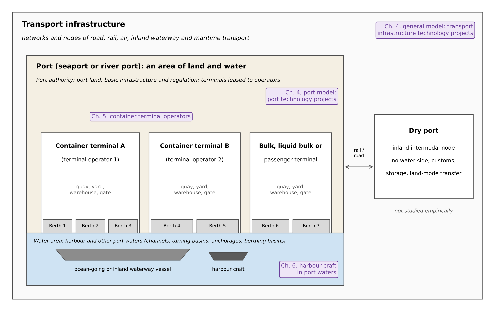
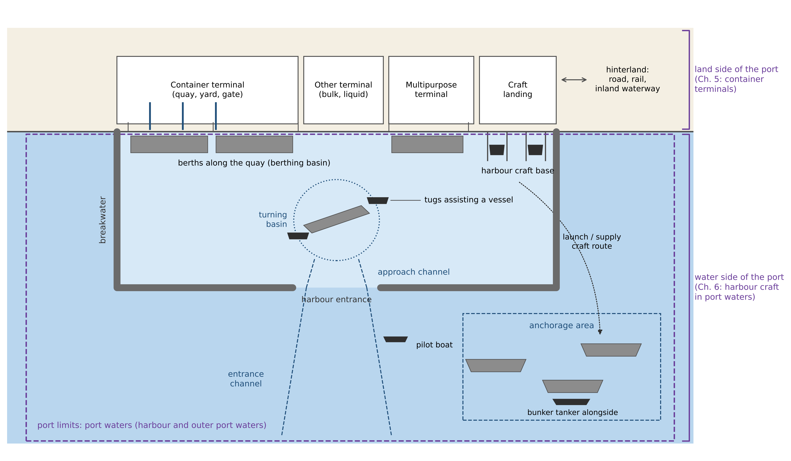

> *Comment 2 (port, terminal and berth not distinguished) and Comment 4 (scope statement on seaports, river ports and dry ports implies a multimodal system that is not studied), as summarised in your initial plan. Related in-text annotations: p. 13 (port vs terminal productivity), p. 22 (seaport, river port, dry port; "Rewrite this part"), p. 23 ("different levels"; "deals with three ports") and p. 24 ("Define port activities… why… harbour craft"). The new Section 1.3.1 also supports the response to Comment 1 (a port is a subset of transport infrastructure).*
>
> *Structure. Part A replaces the current "Research scope" subsection of Section 1.3 in the 10 Oct version with six subsections. 1.3.1 links transport infrastructure to ports. 1.3.2 defines the port from the physical, economic, legal and governance perspectives (Table 1), and distinguishes seaports, river ports and dry ports. 1.3.3 covers harbours: definition, nature, types, layout and harbour craft (Tables 2 and 3, Figure 2). 1.3.4 covers terminals, berths and container terminal layout, including warehouses (Table 4, Figure 3). 1.3.5 distinguishes port infrastructure, superstructure, facilities, equipment and machinery, shows which of them each study covers (Table 5) and ends with a table of the working definitions adopted in the thesis (Table 6). 1.3.6 sets out the scope of each study (Table 7). Each subsection discusses how the sources define a term and then states the definition used in this thesis ("In this thesis, … is defined as …"). The existing "Empirical contexts" subsection becomes 1.3.7 without change. Part B lists the consistency edits elsewhere in the thesis, Part C is the response letter for Comments 2 and 4, and the references follow.*
>
> *"Land side" and "water side". At the scale of the port, the draft uses "the land side of the port" (terminals) and "the water side of the port" (harbour and other port waters). At the scale of the terminal it uses the subsystem names of the operations literature (quayside, horizontal transport, yard, landside interface), because in that literature "landside" means only the truck and rail interface at the gate. This keeps your framing of Chapter 5 (quayside and yard) and Chapter 6 (port waters) without a terminology conflict. Part B applies the same wording elsewhere.*
>
> *Numbering and length. The seven new tables and three new figures come before the existing Table 1 (rationale for the empirical contexts) and Figure 1 (research process flow), which become Table 8 and Figure 4; Word caption fields renumber automatically. If Chapter 1 becomes too long, Sections 1.3.1 to 1.3.5 can be moved into a separate section, "1.3 Key concepts and terminology", followed by "1.4 Research scope and context"; the text works either way. The figures are drawn by me (examiner4/fig, 300 dpi). Notes to you are in grey italic boxes. Everything in Parts A and B is proposed thesis text, to be marked purple; the response in Part C is in green, following your colour scheme.*

# A. SECTION 1.3: REVISED RESEARCH SCOPE

> *Keep the heading "1.3 Research scope and context" and add the short introduction below. Replace the subheading "Research scope" and its six paragraphs (from "This thesis focuses on technology development in ports." to "…environmental performance of ports.") with Sections 1.3.1 to 1.3.6. Renumber "Empirical contexts" as Section 1.3.7.*

Because this thesis examines technology advancement in ports at several levels of analysis, the units to which its findings refer must be defined precisely. Ports differ widely in size, function, site and governance, and the port literature has not settled on a single classification of ports (Bichou & Gray, 2005). The terms used in the thesis are therefore defined first, drawing on official definitions and on the port economics, port engineering and terminal operations literature. Where sources differ, the definition adopted in this thesis is stated explicitly. Sections 1.3.1 to 1.3.5 define the concepts, Section 1.3.6 sets out the scope of the thesis and of each study, and Section 1.3.7 explains the choice of empirical contexts.

## 1.3.1 Transport infrastructure and ports

Transport systems can be described as networks of links and nodes. Links, such as roads, railways, inland waterways and air and sea routes, support movements between nodes, and nodes include the terminals at which passengers and freight enter, leave or change between modes, such as stations, harbours and airports (Rodrigue & Ducruet, 2024). Ports are part of this infrastructure. In the OECD's transport statistics, for example, investment in transport infrastructure covers spending on new construction and on the improvement of the existing network for road, rail, inland waterways, maritime ports and airports (OECD, n.d.). Maritime networks, unlike road and rail networks, are defined more by their nodes than by their links (Rodrigue & Ducruet, 2024), which suggests that ports are the main fixed infrastructure of maritime transport.

The port connects maritime transport with the inland transport system. The port economics literature describes the seaport as an interface between maritime and inland systems of circulation (Notteboom et al., 2022). Its role depends on its connections to the hinterland by road, rail and inland waterway, and dry ports can extend this interface inland (Roso et al., 2009). Because around 80 per cent of the volume of international trade in goods is carried by sea (UNCTAD, 2025), ports are also the main gateways through which national economies are connected to international trade. Technology advancement in ports is therefore part of, and interacts with, technology development in the wider transport infrastructure, in which similar technologies, such as automation, digitalisation and alternative energy, are applied across modes (Section 2.2).

In this thesis, transport infrastructure is defined as the fixed links and nodes, including roads, railways, inland waterways, airports and ports, that support the movement of passengers and freight by road, rail, air, inland waterway and maritime transport. Ports are the nodes of this system at which waterborne transport meets land transport. The focus of the thesis is on ports. The wider transport infrastructure is considered only in the first sub-study of Chapter 4, which places port technology projects in the context of technology projects across all transport modes (Section 1.3.6). Figure 1 gives an overview of the units defined in Sections 1.3.1 to 1.3.5 and of the units examined in each study.

{width=100%}

## 1.3.2 The port: physical, economic, legal and governance definitions

In physical and operational terms, a port is an area of land and water with the facilities needed to receive vessels and to transfer cargo and passengers. European Union law defines a maritime port as an area of land and water made up of the infrastructure and equipment that permits, principally, the reception of waterborne vessels, their loading and unloading, the storage of goods, the receipt and delivery of those goods, and the embarkation and disembarkation of passengers, crew and other persons (Regulation (EU) 2017/352). The Port Law of the People's Republic of China similarly defines a port as an area comprising certain water and land areas, with the functions of vessel entry, departure, anchorage and mooring, passenger embarkation and disembarkation, and cargo loading, unloading, lightering and storage, equipped with the necessary dock facilities, and adds that a port may consist of one or more port areas (Port Law of the People's Republic of China, 2003, Art. 3). Port operations therefore include not only cargo handling but also the services provided to vessels. The EU regulation lists bunkering, cargo handling, mooring, passenger services, the collection of ship-generated waste and cargo residues, pilotage and towage as port services, provided within the port area or on the waterway access to the port (Regulation (EU) 2017/352).

In economic terms, the port is more than a place of cargo transfer. It is a gateway through which trade passes between sea and land, and a node in global supply chains. Notteboom et al. (2022) define the seaport as a logistic and industrial node in global supply chains, with a strong maritime character and a clustering of activities linked to transportation, transformation and distribution. Robinson (2002) argues that ports should be understood as elements in value-driven chain systems, which deliver value to shippers and third-party service providers and capture value for themselves. De Langen (2004) treats seaports as clusters of economic activities related to the arrival of ships and cargo, governed not only by the port authority but also by associations, public–private arrangements and networks of firms. UNCTAD's (1992) classification of port generations describes a similar evolution, from the port as a cargo interface to the port as an industrial and commercial service centre and then as an integrated logistics platform. These economic features also explain why port investment raises policy questions: port infrastructure is capital-intensive, and investment in it is large and lumpy (Haralambides, 2002).

In policy and law, ports are treated both as transport infrastructure and as objects of regulation. Transport policy and statistics count maritime ports as part of the transport infrastructure (OECD, n.d.), and EU State-aid rules distinguish port infrastructure from port superstructure (Commission Regulation (EU) No 651/2014, as amended), a distinction discussed in Section 1.3.5.

In governance terms, a port is an area administered by a port authority. A port authority is a public or private entity that, under national law, administers, develops and manages the port's land and infrastructure and, in some cases, operates it (Notteboom et al., 2022). Its conventional functions are those of landlord, regulator and operator, to which a community manager function has been added (Verhoeven, 2010). The allocation of these functions between public and private actors defines the port management model. In the public service port, the port authority owns the infrastructure and superstructure and provides the services; in the tool port, it owns the infrastructure and superstructure but private firms carry out cargo handling; in the landlord port, it owns the land and basic infrastructure and leases terminals to private operators, which provide their own superstructure and equipment; and in the private service port, these functions are largely private (World Bank, 2007). Under the landlord model, the port as a governance unit and the terminal as an operational unit are therefore managed by different organisations (Section 1.3.4).

Table 1 summarises these perspectives. In this thesis, a port is defined as a node of the transport infrastructure system, consisting of a land area and a water area, that is equipped to receive and serve waterborne vessels and to transfer cargo and passengers between waterborne and land transport, and that is administered by a port authority and contains one or more terminals. A port authority is defined as the body that administers, develops and manages the port's land and basic infrastructure, regulates activities in the port and, depending on the management model, may also provide port services.

Table 1: Perspectives on the definition of a port

| Perspective | How the port is defined | Examples of sources |
|---|---|---|
| Physical and operational | Area of land and water with the facilities to receive vessels and transfer cargo and passengers | Regulation (EU) 2017/352; Port Law of the PRC (2003) |
| Transport network | Node at which maritime and inland waterway transport meet land transport | Rodrigue and Ducruet (2024); Notteboom et al. (2022) |
| Economic | Trade gateway; logistic and industrial node; cluster of port-related firms; element of value-driven chains | UNCTAD (2025); Notteboom et al. (2022); de Langen (2004); Robinson (2002) |
| Legal and policy | Part of transport infrastructure; object of port-service and State-aid rules; infrastructure distinguished from superstructure | OECD (n.d.); Regulation (EU) 2017/352; Regulation (EU) No 651/2014 |
| Governance | Area administered by a port authority under a port management model | World Bank (2007); Verhoeven (2010) |
| This thesis | Node of the transport infrastructure system with a land area and a water area, administered by a port authority and containing one or more terminals | Sections 1.3.1 to 1.3.5 |

Ports can also be distinguished by their location and by the vessels and transport modes they serve. A seaport, or maritime port, receives seagoing vessels, including the ships of international liner and bulk shipping. A river port is an inland waterway port: it is located on a navigable inland waterway, such as a river, canal or lake that is not part of the sea, and receives inland waterway vessels (Eurostat et al., 2019). A dry port has no water side. Under the Intergovernmental Agreement on Dry Ports, it is an inland location that serves as a logistics centre connected to one or more modes of transport, where goods moving in international trade are handled, stored and inspected and customs control and formalities are carried out (ESCAP, 2013). In the dry port concept, such a terminal is linked to a seaport by high-capacity transport, typically rail, so that shippers can deliver and collect containers as if at the seaport itself (Roso et al., 2009). Because the three types of port serve different carriers, namely seagoing ships, inland waterway vessels, and trucks and trains, they also use different equipment and cargo-handling operations, and a study covering all three would need to treat them as parts of a multimodal transport network. This thesis does not take that perspective. In this thesis, a seaport is defined as a port that receives seagoing vessels, and "port" refers to a seaport unless stated otherwise. A river port is defined as a port on a navigable inland waterway that receives inland waterway vessels, and a dry port as an inland terminal without a water side that is linked to one or more seaports and offers handling, storage and customs functions. Dry ports are defined only to delimit the concept of a port and are not studied empirically. Section 1.3.6 specifies which types of port enter each study.

## 1.3.3 Harbours and harbour craft

The terms "port" and "harbour" are often used interchangeably, but they refer to different things. A port is defined by its cargo-handling and passenger functions, whereas a harbour is defined by the shelter it gives to ships; some ports are not sheltered, and some harbours have no port facilities (National Research Council, 1981). In commercial ports the two coincide, since ports are harbour areas in which marine terminal facilities transfer cargo and passengers between ships and land transport (Rodrigue & Notteboom, 2024). In this thesis, a harbour is defined as the sheltered water area of a port, protected naturally or by breakwaters, in which vessels can enter, manoeuvre, anchor and moor. Together with the terminals on land, the harbour forms the port. Port waters are a wider concept. In Singapore, for example, the limits of the port waters are declared by the Maritime and Port Authority of Singapore (MPA) and were revised in 2018 (MPA Singapore, 2018). In this thesis, port waters are defined as the water area within the port limits, comprising the harbour and other designated waters such as anchorages and fairways, and the water side of the port refers to these waters.

Harbours differ in the way they are sheltered. Natural harbours are sheltered by features such as a well-protected bay, the lee of an island or reef, a part of an open bay that is sheltered from the prevailing waves, or the area just upstream from a river mouth (National Research Council, 1981). Other harbours are sheltered artificially by breakwaters, which protect the harbour against waves, currents, tides, wind and storm surges (Notteboom et al., 2022). The World Port Index of the US National Geospatial-Intelligence Agency classifies ports by harbour type according to their physical position relative to the coast and river systems. Of the ports in the index, about 46 per cent are coastal natural harbours, about 18 per cent are coastal breakwater harbours, about 13 per cent are open roadsteads without natural or artificial protection, and less than 1 per cent are coastal tide-gate harbours, in which locks maintain the water level; the remaining types are river and lake or canal harbours (Notteboom et al., 2022, based on the World Port Index). Table 2 summarises these types. Harbours also differ in function, from the harbours of commercial ports to fishing harbours, marinas and naval bases. This thesis is concerned only with the harbours of commercial ports.

Table 2: Harbour types by physical position

| Harbour type | Shelter | Share of ports in the World Port Index |
|---|---|---|
| Coastal natural | Natural features such as a cape, reef or island | About 46% |
| Coastal breakwater | Artificial breakwaters | About 18% |
| Coastal tide gate | Locks or gates that keep the water level in the harbour | Less than 1% |
| Open roadstead | No natural or artificial protection; anchorage only | About 13% |
| River (natural, basin or tide gate) | River banks, dredged basins or locks | Remainder, with lake or canal |
| Lake or canal | Inland water body | |

Sources: Notteboom et al. (2022), based on the World Port Index of the National Geospatial-Intelligence Agency; National Research Council (1981).

> *I could confirm the shares of the four coastal and roadstead types (46.0%, 17.6%, 12.5% and 0.8%) from the Port Economics, Management and Policy companion site, but not the definitions or shares of the river and lake or canal types, which is why the last two rows are kept general. If you can open the page "Harbor Types" (porteconomicsmanagement.org) or the World Port Index itself, you can add the shares for those rows.*

Within a harbour, the main physical elements follow the path of a vessel from the sea to the berth (Figure 2). An entrance channel outside the harbour leads to the harbour entrance between the breakwaters, and an approach channel inside the harbour leads to the turning basin, where vessels, typically assisted by tugs, turn and manoeuvre towards their berths. Berths are located along the quays, next to dredged berthing basins. Anchorage areas are designated areas where ships wait for a berth and where they can be supplied with stores and bunkers (Notteboom et al., 2022). Design guidance for these elements, including approach channels, harbour entrances and manoeuvring and anchorage areas, is set out by PIANC (2014). Table 3 lists the elements, their functions and the harbour craft that typically operate in each.

Table 3: Main elements of a harbour and the harbour craft operating in them

| Element | Function | Harbour craft typically involved |
|---|---|---|
| Entrance channel and harbour entrance | Safe passage between the open sea and the harbour | Pilot boats |
| Breakwaters | Protection of the harbour against waves, currents and storm surges | – |
| Approach channel | Navigation within the harbour towards the basins | Tugs, pilot boats |
| Turning basin | Turning and manoeuvring of vessels towards their berths | Tugs |
| Berths and berthing basins | Mooring for cargo handling and other services | Tugs, mooring boats, bunker tankers |
| Anchorage areas | Waiting for a berth; supply of stores and bunkers | Bunker tankers, launches, supply craft |

Sources: Notteboom et al. (2022); PIANC (2014); MPA Singapore (n.d.); Regulation (EU) 2017/352.

{width=100%}

The vessels that provide services within the port waters are harbour craft. In Singapore, a harbour craft is defined in law as any vessel used in the port for any purpose (Maritime and Port Authority of Singapore Act 1996, s. 2), and harbour craft are licensed by type, including tugs, bulk liquid carriers such as bunker tankers, cargo craft and passenger craft (MPA Singapore, n.d.). About 1,600 harbour craft were operating in the Port of Singapore in 2023 (MPA Singapore, 2023). The US Environmental Protection Agency similarly describes harbour craft as a broad category, including tugs, ferries, workboats, pilot boats and dredges, which perform a variety of jobs in and near a single port or region (US EPA, n.d.). Harbour craft provide several of the port services listed in Section 1.3.2, such as towage, mooring assistance, bunkering and the transport of pilots, crew, passengers and supplies, so they differ from the seagoing ships that call at the port. Port emission inventories accordingly treat harbour craft as a separate source category of port-related emissions, alongside ocean-going vessels, cargo-handling equipment, on-road vehicles and rail (US EPA, 2022). In this thesis, harbour craft are defined as vessels that operate within port waters to provide port services, such as towage, bunkering and the transport of pilots, crew, passengers and supplies, as distinct from the seagoing ships that call at the port. Their operations are treated as part of port operations on the water side of the port, which is the setting of Chapter 6.

## 1.3.4 Terminals, berths and container terminal layout

Within a port, cargo is handled in terminals. A terminal is a part of the port's land area, with its own quay, storage areas and handling equipment, that is dedicated to a particular type of cargo or traffic, such as containers, dry bulk, liquid bulk or passengers (Rodrigue & Notteboom, 2024). Under the landlord model, terminal operating companies lease the terminals from the port authority, provide and maintain the superstructure and equipment, and are responsible for terminal operations (World Bank, 2007). A large container port can therefore contain several container terminals run by different operators, including global terminal operators that hold terminals in many ports around the world (Notteboom & Rodrigue, 2012). A container terminal is a terminal at which containers are transferred between modes of transport, from ships to barges, trucks and trains and vice versa, using several types of handling equipment (Vis & de Koster, 2003). Along the quay of a terminal, vessels moor at berths. A berth is the location at which a vessel is stopped and secured for cargo transfer or other purposes (Bureau of Transportation Statistics, n.d.), and in container terminals the quay is either divided into a fixed number of discrete berths or treated as a continuous quay along which vessels are assigned positions (Bierwirth & Meisel, 2010).

In this thesis, a terminal is defined as an area on the land side of a port, with its own quay, storage area and equipment, that handles a particular type of cargo or traffic and is operated as a unit, usually by a terminal operator. A container terminal is a terminal that handles containers, transferring them between ships and other transport modes. A terminal operator is the company that operates a terminal, provides its superstructure and equipment and manages its operations, usually under a lease or concession from the port authority. A berth is a designated position along a quay where a vessel is moored for cargo handling or other services.

Port, terminal and berth are therefore nested units: a port contains one or more terminals, and a terminal contains one or more berths (Figure 1). The distinction matters for measurement. The container throughput of a port is the total of the volumes handled by its terminals, whereas the equipment and operating practices of each terminal are decided by its operator (World Bank, 2007), so terminals in the same port may differ in equipment and performance. In this thesis, "port" refers to the port as a whole, "terminal" to the operational unit managed by a terminal operator, and "berth" to the mooring position at the quay. The empirical analysis in Chapter 5 is conducted at the level of container terminal operators, not of ports.

Container terminals are the setting of the organisational-level study, and their internal organisation determines which equipment and technologies that study can observe. The terminal operations literature describes a container terminal as a system of linked subsystems through which containers move between the ship and the hinterland (Steenken et al., 2004; Stahlbock & Voß, 2008). At the quayside, quay cranes (QCs), also known as ship-to-shore (STS) cranes, unload and load vessels at the berth (Bierwirth & Meisel, 2010). Horizontal transport equipment, such as yard trucks, straddle carriers and automated guided vehicles (AGVs), moves containers between the quay and the storage yard (Carlo et al., 2014b). In the yard, containers are stacked in blocks and handled by yard cranes, such as rubber-tyred gantry cranes (RTGs), rail-mounted gantry cranes (RMGs) or automated stacking cranes (ASCs) (Carlo et al., 2014a). At the landside interface, containers are transferred to and from trucks at the gate and trains at rail terminals (Gharehgozli et al., 2016; Kim, 2023). Terminals also contain warehouses and technical buildings (Notteboom et al., 2022). In container terminals, warehouses such as container freight stations are used to consolidate and deconsolidate less-than-container-load cargo [source to be confirmed]. Table 4 summarises these subsystems and the equipment used in each.

The arrangement of the yard blocks relative to the quay is a basic design decision. In one layout, the blocks are parallel to the quay, and containers are transferred beside the blocks, where yard trucks travel in lanes alongside them. In the other, the blocks are perpendicular to the quay, and containers are transferred at the two ends of each block, an arrangement used in automated terminals with automated stacking cranes (Kim et al., 2008; Lee & Kim, 2013; Kim, 2023). Figure 3 illustrates both layouts. The layout affects the choice of handling equipment as well as terminal productivity, and the better layout depends on design parameters such as storage requirements and the throughput capacity of the yard cranes and transporters used (Lee & Kim, 2013). For example, for terminals using automated lifting vehicles with an internal transport area of the same width, the parallel layout was found to reduce container throughput times by 4–12% compared with the perpendicular layout (Gupta et al., 2017).

Two scales of the distinction between land and water are therefore used in this thesis. At the scale of the port, the land side comprises the terminal areas, including their quays, yards and gates, and the water side comprises the port waters, including the harbour and the anchorages (Section 1.3.3; Figure 2). At the scale of the terminal, the operations literature uses "quayside" or "seaside" for the ship-to-shore interface and "landside" for the interface with trucks and trains (Steenken et al., 2004; Gharehgozli et al., 2016). In this thesis, "the land side of the port" and "the water side of the port" are used in the port-scale sense, and the terminal subsystems are referred to by their names. Figure 3 shows both scales and the parts covered by Chapters 5 and 6.

Chapter 5 examines cargo-handling equipment on the land side of the port, in the quayside and yard subsystems of container terminals, namely the number and capacity of STS cranes and yard gantry cranes. The Malmquist productivity index used in Chapter 5 also takes the berth length, berth depth, number of berths and terminal area of each terminal as inputs (Section 5.3.1). Horizontal transport equipment, gate operations, warehouses and yard layout are not modelled, because the terminal-level yearbook data used in Chapter 5 do not report them consistently across operators and years (Section 5.3.2). They are treated as part of the operating context of each terminal, and their omission is discussed as a limitation in Section 5.6. Chapter 6 turns to the water side of the port, where harbour craft operate.

> *The sentence on container freight stations is marked "[source to be confirmed]": I found only practitioner glossaries for it, not an academic or official source. Please check whether Kim (2023) or Steenken et al. (2004) describe the container freight station; if so, cite it there, and if not, delete that sentence and keep "warehouses and technical buildings (Notteboom et al., 2022)". Please also confirm the reason given for not modelling horizontal transport, gate operations and yard layout, i.e. that the China Ports Yearbook does not report these items consistently for the 46 operators. If the yearbook does report, for example, the number of yard trucks or AGVs, the sentence should give the actual reason instead. The limitation in Section 5.6 will be drafted with Comment 10 (terminal layout and horizontal transport).*

Table 4: Container terminal subsystems and their coverage in this thesis

| Area or subsystem | Main operations | Typical equipment | Coverage in this thesis |
|---|---|---|---|
| Water side of the port (port waters) | Vessel approach and mooring; towage, bunkering and other port services | Ships; harbour craft (tugs, bunker tankers, cargo and passenger craft) | Chapter 6: harbour craft fuel use and emissions |
| Quayside (berth and apron) | Unloading and loading of vessels | QCs (STS cranes) | Chapter 5: number and capacity of STS cranes; berth length, depth and number (MPI inputs) |
| Horizontal transport | Movement of containers between quay and yard | Yard trucks, straddle carriers, AGVs | Context only |
| Yard | Stacking, storage and retrieval of containers | RTGs, RMGs, ASCs, straddle carriers | Chapter 5: number and capacity of yard gantry cranes; terminal area (MPI input) |
| Landside interface | Transfer to and from trucks and trains; gate processing | Gate systems, rail cranes | Context only |
| Warehouses and buildings | Storage and handling of goods; maintenance and administration | Warehouses (e.g., container freight stations), workshops, offices | Context only |

Sources: Regulation (EU) 2017/352; MPA Singapore (n.d.); Steenken et al. (2004); Bierwirth and Meisel (2010); Carlo et al. (2014a, 2014b); Gharehgozli et al. (2016); Notteboom et al. (2022).

{width=100%}

> *Please check Figure 3 and the layout paragraph against Kim (2023), Fig. 1.1, Fig. 1.2 and Table 1.6, which Examiner 3 recommends. I could confirm the book (Elsevier, ISBN 978-0-443-13823-2) and its table of contents, but not the text of those figures. In particular, please confirm that Kim describes the perpendicular layout as the one used in automated terminals with ASCs; if not, delete "Kim, 2023" from that sentence. Page numbers for Kim (2023) would also help.*

## 1.3.5 Port infrastructure, superstructure, facilities and equipment

The port literature and port policy distinguish several categories of physical assets, which differ in function, in durability and in who usually provides them. The World Bank's Port Reform Toolkit distinguishes basic port infrastructure, operational port infrastructure, port superstructure and port equipment, so that each type of investment can be assigned to the port authority, to government or to private investors. In landlord ports, the general infrastructure has typically been financed by government and the port authority, and the terminal superstructure and equipment by private operators (World Bank, 2007). EU State-aid rules draw a similar line between port infrastructure, such as berths, quay walls, jetties, internal basins, backfills and land reclamation, and port superstructure, which covers surface facilities for storage, fixed equipment and buildings such as warehouses and terminal buildings, and mobile equipment such as cranes (Commission Regulation (EU) No 651/2014, as amended). Port terminals are thus integrated systems of infrastructure and superstructure, whose main elements include terminal handling equipment, such as STS cranes and yard equipment, and warehouses and technical buildings, all of which require substantial capital investment (Notteboom et al., 2022). The term "facility" is used more broadly. In maritime security regulation, for example, a port facility is a location where the ship–port interface takes place, including areas such as anchorages, waiting berths and approaches from seaward (Regulation (EC) No 725/2004).

These distinctions matter for the study of technology, because most technologies are embodied in physical assets (Section 2.1.2), and different assets are provided by different actors. Port infrastructure is long-lived and capital-intensive, and investment in it is large and lumpy (Haralambides, 2002), so technology enters it mainly through major projects, typically initiated by port authorities and governments. Terminal superstructure and equipment are provided by terminal operators (World Bank, 2007), so technology enters them through the operators' purchase of new cranes, vehicles and systems. Vessels and their machinery are provided by shipowners and harbour craft operators. Software, such as terminal operating systems and data platforms, is installed across all these assets (Section 2.3).

The studies of this thesis cover these categories to different degrees, as shown in Table 5. Study 1 reviews technologies in all categories. Study 2 analyses technology projects in transport and port infrastructure in a broad sense. These projects may involve infrastructure, facilities, equipment and digital systems, such as facilities for LNG bunkering (European Commission, 2023b), but they are measured at the national level by the number, duration and cost of projects rather than by type of asset (Section 4.3.1). Study 3 concerns the infrastructure and equipment of container terminals. Its growth model analyses the number and capacity of STS cranes and yard gantry cranes, which belong to the equipment provided by terminal operators, and its productivity analysis also uses infrastructure inputs, namely the berth length, berth depth, number of berths and terminal area (Section 5.3.1). Study 4 concerns vessels and their machinery: harbour craft and their diesel engines operating on biofuel blends, together with the onboard sensors and machine-learning tools used to predict their performance. Superstructure such as warehouses, gates and buildings is not studied empirically.

In this thesis, port infrastructure is defined as the basic, largely fixed assets of the port, such as channels, basins, breakwaters, quay walls, berths and terminal land. Port superstructure is defined as the paving, buildings and fixed facilities installed on the infrastructure, such as warehouses and terminal buildings. "Port facility" is used as a general term for any location or built element of the port where the ship–port interface or cargo handling takes place. Equipment is defined as the machines used to handle cargo or to serve vessels, such as cranes and vehicles, and machinery as the engines and energy systems that power equipment and vessels, such as the diesel engines of harbour craft. Although EU State-aid rules include mobile equipment in the superstructure, this thesis treats equipment separately, following the World Bank (2007), because the technologies analysed in Chapter 5 are embodied in the equipment itself.

Table 5: Physical components of a port and their coverage in this thesis

| Component | Examples | Usually provided by (landlord model) | Coverage in this thesis |
|---|---|---|---|
| Port infrastructure | Channels, breakwaters, basins, quay walls, berths, terminal land | Government and port authority | Chapter 4 (projects, national level); Chapter 5 (berth and area inputs to the MPI) |
| Port superstructure and facilities | Paving, warehouses, terminal buildings, energy supply facilities | Terminal operators | Chapter 4 (projects, national level); otherwise context only |
| Equipment | QCs (STS cranes), yard cranes, horizontal transport vehicles | Terminal operators | Chapter 5 (STS cranes and yard gantry cranes) |
| Vessels and machinery | Harbour craft, engines, fuel systems, onboard sensors | Harbour craft operators | Chapter 6 (harbour craft engines on biofuel blends) |
| Software and digital systems | Terminal operating systems, data platforms, ML tools | All actors | Chapter 3 (review); Chapter 4 (digitalisation projects); Chapter 6 (ML prediction) |

Sources: World Bank (2007); Commission Regulation (EU) No 651/2014; Notteboom et al. (2022); Regulation (EC) No 725/2004.

> *Please check two points. (1) "Energy supply facilities" and "facilities for LNG bunkering" in Chapter 4 rely on the TRIMIS example already used in file 05 (European Commission, 2023b); if your port projects include other typical items, such as shore power or digital platforms, you can name them instead. (2) I described Study 2's projects as possibly involving infrastructure, facilities and equipment; if your screening (Section 4.3.3) restricted the port projects to a narrower type, adjust the sentence.*

Table 6 brings together the working definitions adopted in this thesis.

Table 6: Working definitions of the key terms used in this thesis

| Term | Working definition in this thesis | Based on |
|---|---|---|
| Transport infrastructure | Fixed links and nodes (roads, railways, inland waterways, airports, ports) that support passenger and freight movement by all modes | Rodrigue and Ducruet (2024); OECD (n.d.) |
| Port | Node of the transport infrastructure system with a land area and a water area, equipped to receive and serve vessels and transfer cargo and passengers, administered by a port authority and containing one or more terminals | Regulation (EU) 2017/352; Port Law of the PRC (2003); Notteboom et al. (2022) |
| Seaport | Port that receives seagoing vessels; "port" means seaport unless stated otherwise | Regulation (EU) 2017/352 |
| River port | Port on a navigable inland waterway that receives inland waterway vessels | Eurostat et al. (2019) |
| Dry port | Inland terminal without a water side, linked to one or more seaports, with handling, storage and customs functions | ESCAP (2013); Roso et al. (2009) |
| Port authority | Body that administers, develops and manages port land and basic infrastructure, regulates port activities and may provide port services | Notteboom et al. (2022); Verhoeven (2010) |
| Port infrastructure | Basic, largely fixed assets: channels, basins, breakwaters, quay walls, berths, terminal land | World Bank (2007); Regulation (EU) No 651/2014 |
| Port superstructure | Paving, buildings and fixed facilities on the infrastructure, e.g., warehouses and terminal buildings | World Bank (2007); Regulation (EU) No 651/2014 |
| Port facility | General term for any location or built element where the ship–port interface or cargo handling takes place | Regulation (EC) No 725/2004 |
| Equipment | Machines used to handle cargo or serve vessels, e.g., cranes and vehicles | World Bank (2007); Notteboom et al. (2022) |
| Machinery | Engines and energy systems of equipment and vessels, e.g., harbour craft diesel engines | This thesis (Chapter 6) |
| Harbour | Sheltered water area of a port, protected naturally or by breakwaters, where vessels enter, manoeuvre, anchor and moor | National Research Council (1981); Rodrigue and Notteboom (2024) |
| Port waters (water side of the port) | Water area within the port limits: the harbour plus anchorages and fairways | MPA Singapore (2018); Notteboom et al. (2022) |
| Terminal (land side of the port) | Area on the land side of a port with its own quay, storage and equipment, handling one type of cargo or traffic and operated as a unit | Rodrigue and Notteboom (2024); World Bank (2007) |
| Container terminal | Terminal that transfers containers between ships and other transport modes | Vis and de Koster (2003) |
| Terminal operator | Company that operates a terminal, provides its superstructure and equipment and manages its operations | World Bank (2007); Notteboom and Rodrigue (2012) |
| Berth | Designated position along a quay where a vessel is moored for cargo handling or other services | Bureau of Transportation Statistics (n.d.); Bierwirth and Meisel (2010) |
| Harbour craft | Vessels operating within port waters to provide port services, as distinct from the seagoing ships calling at the port | MPA Act 1996, s. 2; MPA Singapore (n.d.); US EPA (n.d.) |

## 1.3.6 Scope of the thesis and of each study

Building on these definitions, this thesis focuses on technology advancement in ports, that is, on how technologies are developed, adopted and evaluated in port infrastructure, in terminal cargo-handling equipment and in the operation of harbour craft. Technology is understood to include both hardware and software. Hardware-based technologies include physical infrastructure, cargo-handling equipment, alternative-fuelled machinery and onboard energy technologies, and software-based technologies include digital and information systems, data platforms, algorithmic tools and other ICT-enabled applications. Both categories are recognised throughout the thesis, but the empirical emphasis differs between the studies, as set out below and summarised in Table 7.

Study 1 (Chapter 3) is a systematic literature review of the theories that explain port technology development. It covers studies of ports, seaports, harbours and terminals (Section 3.2) and examines the role of technology advancement in port development and the economic, institutional and organisational theories used to explain it.

Study 2 (Chapter 4) is conducted at the national level. From an investment perspective, it examines how government incentives for R&D, national innovation input and the technology development level of a country are associated with the participation of a country's organisations in technology projects. Because ports are part of the wider transport infrastructure (Section 1.3.1), the chapter consists of two sub-studies. The first places ports in this wider context. It analyses transport infrastructure projects with a technological component, such as automation, digitalisation or sustainable energy, across air, rail, road, inland waterway and maritime transport, drawn from the European Commission's TRIMIS database for 35 European countries (Section 4.3.3). The second narrows the analysis to port infrastructure projects. In both sub-studies, the unit of analysis is the country, and ports enter the analysis as the location of technology projects [, which concern maritime ports and inland ports]. The chapter therefore does not examine the operations of individual ports or terminals, or the connections between ports in a multimodal transport network.

> *Please confirm the bracketed clause. Your previous scope text said the Chapter 4 port model covered "seaports, river ports, and dry ports", and the TRIMIS search included the inland waterway and maritime modes. (1) If the port projects concern both maritime and inland ports, keep the clause. (2) If any project concerns a dry port, add "and dry ports". (3) If all the port projects concern seaports, replace the clause with ", all of which concern seaports". Option (3) is the cleanest answer to Comment 4, so it is worth checking the project list.*

Study 3 (Chapter 5) is conducted at the organisational level, in container terminals. Its unit of analysis is the container terminal operator, and its sample consists of 46 container terminal operators in Chinese [coastal] ports, observed from 2015 to 2021 (Section 5.3.2). Within the terminal, it covers the quayside and yard subsystems. It examines how the number and capacity of STS cranes and yard gantry cranes are associated with container throughput over time, and how technological progress, measured by the Malmquist productivity index with berth, terminal-area, crane and labour inputs, is related to the education level of the workforce and to ownership structure. Horizontal transport, gate operations, warehouses, yard layout and other types of terminal, such as bulk or passenger terminals, are outside its empirical scope.

> *Please confirm "[coastal]". If some of the 46 operators are in Yangtze River ports, such as Nanjing or Taicang, write "in Chinese coastal and river ports" instead, and say so again in Section 5.3.2.*

Study 4 (Chapter 6) is conducted at the operational level, on the water side of the port. It examines the adoption of biofuel as a sustainable energy technology in harbour craft operating in the port waters of Singapore. Using onboard sensor data collected in sea trials with conventional diesel and biofuel blends, it applies machine-learning models to predict fuel consumption and emissions. The study concerns harbour craft only and does not extend to the seagoing ships that call at the port.

Overall, the thesis is delimited to the technological aspects of port development. Apart from the first sub-study of Chapter 4, which places ports within the wider transport infrastructure, it does not examine the technologies of other transport modes, the technologies of seagoing ships, the multimodal connections between seaports, river ports and dry ports, or broader trade policy. Fishing harbours, marinas and naval bases are also outside its scope.

Table 7: Scope of the four studies

| Study (chapter) | Level | Unit of analysis | Part of the port | Technologies examined | Outside the scope |
|---|---|---|---|---|---|
| Study 1 (Ch. 3) | Theoretical | Published studies | Ports, seaports, harbours, terminals | Port technologies in general | Empirical testing |
| Study 2 (Ch. 4) | National | Country (35 European countries) | Transport infrastructure (first sub-study); port infrastructure (second sub-study) | Technology projects, e.g., automation, digitalisation, sustainable energy | Operations of individual ports; multimodal links |
| Study 3 (Ch. 5) | Organisational | Container terminal operator (46, China) | Land side: quayside and yard subsystems | STS cranes, yard gantry cranes; berth and area inputs; technological progress | Horizontal transport, gate, warehouses, layout; other terminal types |
| Study 4 (Ch. 6) | Operational | Harbour craft (Singapore) | Water side: port waters | Biofuel blends; machine-learning prediction | Seagoing ships |

## 1.3.7 Empirical contexts

> *The existing "Empirical contexts" text follows here unchanged, apart from its new number. Two small points to check while you are there: the "Setting" cell for Study 2 in the rationale table says "European Union", but the sample has 35 European countries, which cannot all be EU members, so "European countries" is safer; and the paragraph on China still contains two question marks ("frontier analysis?", "vary considerably ?").*

# B. CONSISTENCY EDITS ELSEWHERE IN THE THESIS

> *These sentences use "landside" or "waterside" in a way that conflicts with the terminal-scale meaning defined in Section 1.3.4, or describe the scope differently from Section 1.3.6. Page numbers refer to the 10 Oct version. Your initial plan for Comment 1 says that "the closing sentence of the Research Scope section" was revised; since that subsection is now replaced, please update the Comment 1 response to refer to Sections 1.3.1 and 1.3.6.*

| Location | Current text | Revised text |
|---|---|---|
| Summary | "…focuses on the sustainability aspect at port waterside." | "…focuses on sustainability on the water side of the port." |
| 1.2, Objective 3 | "on organisational level, the thesis focuses on landside equipment, …" | "at the organisational level, the thesis focuses on cargo-handling equipment in the quayside and yard subsystems of container terminals, …" |
| 1.2, Objective 4 | "on operational level, the thesis focuses on waterside harbour craft, …" | "at the operational level, the thesis focuses on harbour craft operating on the water side of the port, …" |
| 1.4, third stage | "…for the port terminals at landside, where…" | "…in container terminals, on the land side of the port, where…" |
| 1.4, fourth stage | "…focusing on environmental sustainability at the waterside operation of the ports." | "…focusing on environmental sustainability in harbour craft operations on the water side of the port." |
| 1.5 | "…how landside equipment deployment is associated with throughput growth…" | "…how the deployment of quay cranes and yard cranes is associated with throughput growth…" |
| 1.5 | "…sustainable technology adoption in port waterside operations." | "…sustainable technology adoption in port operations on the water side of the port." |
| 1.6, Chapter 5 | "Chapter 5 zooms in to focus on port terminal operation on landside, …" | "Chapter 5 focuses on container terminal operations in the quayside and yard subsystems, …" |
| 1.6, Chapter 6 | "Chapter 6 focuses on waterside port operations." / "…in waterside port operations for the port like Singapore." | "Chapter 6 focuses on port operations on the water side of the port." / "…in harbour craft operations in ports such as Singapore." |
| 6, introduction | "…and landside productivity (equipment deployment and technological progress in container terminals)." | "…and terminal productivity on the land side of the port (equipment deployment and technological progress in container terminals)." |
| 6, introduction | "Other than looking into cargo handling equipment from landside presented in previous chapter, this chapter focuses on waterside operation from harbour craft…" | "Whereas Chapter 5 examined cargo-handling equipment on the land side of the port, this chapter focuses on harbour craft operations on the water side…" |
| 6.1 | "…particularly in cargo-handling equipment, which dominate energy use within ports landside emissions." | "…particularly in cargo-handling equipment, which dominates energy use and emissions on the land side of ports." |
| 6.1 | "…extends the coverage from landside to waterside operation." | "…extends the coverage from the land side to the water side of the port." |
| 7.1.2 | "…decarbonisation in both landside and waterside port activities." | "…decarbonisation in port activities on both the land side and the water side." |

# C. RESPONSE TO EXAMINER 3

> *For the response letter, to be placed under Comments 2 and 4 in your initial plan. Page numbers will be added once the revised thesis is paginated.*

**Comment 2 – Port vs. terminal vs. berth not distinguished**

Response: I thank the examiner for this important comment, and I agree that the distinction between a port, a terminal and a berth was not made clearly enough. A port is a subset of transport infrastructure; a container port typically contains several terminals, which may be leased to and run by different terminal operators, including global terminal operators; and each terminal has one or more berths. The revised thesis now makes these distinctions explicit at the start, in Sections 1.3.1 to 1.3.5. Section 1.3.1 explains how ports relate to the wider transport infrastructure, as the nodes at which waterborne transport meets land transport. Section 1.3.2 defines the port from the physical and operational, transport network, economic, legal and policy, and governance perspectives (Table 1), including the role of the port authority and the port management models of the World Bank Port Reform Toolkit, and distinguishes seaports, river ports and dry ports. Section 1.3.3 defines the harbour and port waters, describes the types and layout of harbours (Tables 2 and 3, Figure 2), and defines harbour craft. Section 1.3.4 defines the terminal, container terminal, terminal operator and berth, and explains that, under the landlord model, terminal operators provide their own equipment and run their own operations, so that terminals in the same port may differ in equipment and performance, and that port throughput is the sum of the volumes handled by its terminals. The definitions draw on official and academic sources, including Regulation (EU) 2017/352 on port services, the Port Law of the People's Republic of China, the Glossary for Transport Statistics, the UN Intergovernmental Agreement on Dry Ports, the World Bank Port Reform Toolkit, Notteboom, Pallis and Rodrigue (2022), Notteboom and Rodrigue (2012) and Vis and de Koster (2003). Section 1.3.5 distinguishes port infrastructure, superstructure, facilities, equipment and machinery, and shows which of them each study covers (Table 5). Because sources define these terms in different ways, each subsection states the definition adopted in this thesis, and Table 6 brings these working definitions together. Figure 1 shows the port, its harbour, its terminals and their berths as nested units. The terms are now used consistently throughout the thesis: "port" refers to the port as a whole, "terminal" to the operational unit run by a terminal operator, and "berth" to the mooring position at the quay. Section 1.3.6 states that the unit of analysis in Chapter 5 is the container terminal operator, not the port. [The sentence on p. 13 that combined port productivity and "port terminal productivity" has been revised to refer to container terminals; see also the response to Comment 5.]

In addition, Section 1.3.4 describes the subsystems of a container terminal (quayside, horizontal transport, yard, landside interface, and warehouses and buildings) and the two basic yard layouts, with blocks parallel or perpendicular to the quay, drawing on Kim (2023), as the examiner recommended, and on Steenken et al. (2004), Lee and Kim (2013) and Gupta et al. (2017). Figure 3 and Table 4 show these subsystems and indicate which of them are covered by Chapters 5 and 6. The section also states that horizontal transport, gate operations and yard layout are not modelled in Chapter 5 and are treated as context; this point is taken up further in the response to Comment 10.

**Comment 4 – Scope statement implies a multimodal system not discussed in the thesis**

Response: I thank the examiner for pointing out this inconsistency, and I agree that the statement that the scope "includes seaports, river ports, and dry ports" implied a multimodal transport system that the thesis does not analyse. The statement has been removed. Section 1.3.2 now defines the three types of port and explains that they serve different carriers (seagoing ships, inland waterway vessels, and trucks and trains) and therefore use different equipment and cargo-handling operations, so that studying them together would require a multimodal network perspective. It then states that the thesis does not take that perspective, that "port" refers to a seaport unless stated otherwise, and that dry ports are defined only to delimit the concept of a port. Section 1.3.6 specifies, for each study, the level of analysis, the unit of analysis, the part of the port covered and the technologies examined (Table 7). Chapter 4 is a national-level study in which the country is the unit of analysis; its first sub-study places ports in the wider transport infrastructure, and its second sub-study analyses port infrastructure technology projects, in which ports appear as the location of the projects [, which concern maritime and inland ports]. Chapter 5 studies container terminal operators in Chinese ports, and Chapter 6 studies harbour craft in the port waters of Singapore. Section 1.3.6 also states that the thesis does not examine the multimodal connections between seaports, river ports and dry ports.

Regarding the examiner's related remark on p. 23 about the different "levels", Section 1.3.6 now explains that the national, organisational and operational levels are levels of analysis, each with its own unit of analysis: the country in Chapter 4, the container terminal operator in Chapter 5 and the harbour craft in Chapter 6 (Table 7). Regarding the remark on p. 24 asking why harbour craft relate to port activities, Section 1.3.3 now defines the harbour and port waters, describes the harbour elements in which harbour craft operate (Table 3, Figure 2), and defines harbour craft as vessels used within the port that provide port services such as towage, bunkering and the transport of pilots, crew, passengers and supplies (Maritime and Port Authority of Singapore Act 1996; Regulation (EU) 2017/352). It also notes that port emission inventories treat harbour craft as a separate source of port-related emissions (US EPA, 2022). Harbour craft operations are therefore treated as part of port operations on the water side of the port, which is the scope of Chapter 6.

# REFERENCES

> *New entries for the reference list (APA 7). † = already in your list. ‡ = a detail I could not confirm (stated after the entry). "(file 04)" or "(file 03)" = also added by that file, so do not add it twice. Two fixes to your existing list: (1) replace the World Bank (2025) entry for the Port Reform Toolkit web page with the World Bank (2007) entry below, which identifies the edition and module cited; (2) the entry "MPA Singapore, M. P. A. (2023)" has a duplicated author and should read "MPA Singapore. (2023)".*

Bichou, K., & Gray, R. (2005). A critical review of conventional terminology for classifying seaports. *Transportation Research Part A: Policy and Practice, 39*(1), 75–92. https://doi.org/10.1016/j.tra.2004.11.003

Bierwirth, C., & Meisel, F. (2010). A survey of berth allocation and quay crane scheduling problems in container terminals. *European Journal of Operational Research, 202*(3), 615–627. https://doi.org/10.1016/j.ejor.2009.05.031

Bureau of Transportation Statistics. (n.d.). *Port Performance Freight Statistics Program: Glossary*. U.S. Department of Transportation. https://www.bts.gov/sites/bts.dot.gov/files/docs/browse-statistical-products-and-data/port-performance/217681/ppfsp-glossary.pdf ‡ (publication year not shown in the record)

Carlo, H. J., Vis, I. F. A., & Roodbergen, K. J. (2014a). Storage yard operations in container terminals: Literature overview, trends, and research directions. *European Journal of Operational Research, 235*(2), 412–430. https://doi.org/10.1016/j.ejor.2013.10.054 (file 04)

Carlo, H. J., Vis, I. F. A., & Roodbergen, K. J. (2014b). Transport operations in container terminals: Literature overview, trends, research directions and classification scheme. *European Journal of Operational Research, 236*(1), 1–13. https://doi.org/10.1016/j.ejor.2013.11.023 (file 04)

Commission Regulation (EU) No 651/2014 of 17 June 2014 declaring certain categories of aid compatible with the internal market in application of Articles 107 and 108 of the Treaty, as amended by Commission Regulation (EU) 2017/1084. *Official Journal of the European Union*. http://data.europa.eu/eli/reg/2014/651/oj ‡ (wording of the port infrastructure and superstructure definitions checked only through secondary copies; please check Article 2 of the current consolidated text)

de Langen, P. W. (2004). Governance in seaport clusters. *Maritime Economics & Logistics, 6*(2), 141–156. https://doi.org/10.1057/palgrave.mel.9100100

ESCAP. (2013). *Intergovernmental Agreement on Dry Ports*. United Nations Economic and Social Commission for Asia and the Pacific. https://treaties.un.org/doc/Treaties/2013/11/20131107%2012-02%20PM/XI-E-3.pdf

European Commission. (2023b). *Transport Research and Innovation Monitoring and Information System*. https://trimis.ec.europa.eu †

Eurostat, ITF, & UNECE. (2019). *Glossary for transport statistics* (5th ed.). Publications Office of the European Union. https://ec.europa.eu/eurostat/web/products-manuals-and-guidelines/-/ks-gq-19-004 ‡ (definition wording checked through a mirrored copy, as the PDF could not be opened)

Gharehgozli, A. H., Roy, D., & de Koster, R. (2016). Sea container terminals: New technologies and OR models. *Maritime Economics & Logistics, 18*(2), 103–140. https://doi.org/10.1057/mel.2015.3 †

Gupta, A., Roy, D., de Koster, R., & Parhi, S. (2017). Optimal stack layout in a sea container terminal with automated lifting vehicles. *International Journal of Production Research, 55*(13), 3747–3765. https://doi.org/10.1080/00207543.2016.1273561

Haralambides, H. E. (2002). Competition, excess capacity, and the pricing of port infrastructure. *International Journal of Maritime Economics, 4*(4), 323–347. https://doi.org/10.1057/palgrave.ijme.9100053 (file 03)

Kim, K. H. (2023). *Planning and operation of container terminals*. Elsevier. ISBN 978-0-443-13823-2. https://shop.elsevier.com/books/planning-and-operation-of-container-terminals/kim/978-0-443-13823-2 ‡ (Elsevier lists both October 2023 and January 2024 as the publication date; use the year printed in your copy)

Kim, K. H., Park, Y.-M., & Jin, M.-J. (2008). An optimal layout of container yards. *OR Spectrum, 30*(4), 675–695. https://doi.org/10.1007/s00291-007-0111-6

Lee, B. K., & Kim, K. H. (2013). Optimizing the yard layout in container terminals. *OR Spectrum, 35*(2), 363–398. ‡ (DOI not confirmed)

Maritime and Port Authority of Singapore Act 1996, s. 2 (Singapore). https://sso.agc.gov.sg/Act/MPASA1996

MPA Singapore. (n.d.). *Licensing of harbour craft and pleasure craft*. Maritime and Port Authority of Singapore. https://www.mpa.gov.sg/port-marine-ops/harbourcraft-and-pleasure-craft-regulations/licensing-of-harbour-craft-pleasure-craft

MPA Singapore. (2018). *Port Marine Circular No. 9 of 2018: Revised port limits*. Maritime and Port Authority of Singapore. https://www.mpa.gov.sg/docs/mpalibraries/circulars-and-notices/port-marine-circulars/-pc18-09 ‡ (circular title paraphrased; please use the exact title on the circular)

MPA Singapore. (2023). *Call for expression of interest to design and promote adoption of electric harbour craft in Singapore*. Maritime and Port Authority of Singapore. † (author format to be corrected, see note above)

National Research Council. (1981). *Problems and opportunities in the design of entrances to ports and harbors*. National Academy Press. https://doi.org/10.17226/745

Notteboom, T., Pallis, A., & Rodrigue, J.-P. (2022). *Port economics, management and policy*. Routledge. https://doi.org/10.4324/9780429318184 ‡ (definitions checked on the book's companion website, porteconomicsmanagement.org; please add page numbers from the book; a second edition appeared in 2026)

Notteboom, T., & Rodrigue, J.-P. (2012). The corporate geography of global container terminal operators. *Maritime Policy & Management, 39*(3), 249–279. https://doi.org/10.1080/03088839.2012.671970

OECD. (n.d.). *Infrastructure investment* (indicator). OECD. https://www.oecd.org/en/data/indicators/infrastructure-investment.html

PIANC. (2014). *Harbour approach channels: Design guidelines* (PIANC Report No. 121). PIANC – The World Association for Waterborne Transport Infrastructure.

Port Law of the People's Republic of China. (2003, as amended). Art. 3. English translation: https://www.lexiscn.com/law/law-english-1-3064244-T.html ‡ (translation of the 2015 revised text; please check that Article 3 is unchanged in the 2018 amendment)

Regulation (EC) No 725/2004 of the European Parliament and of the Council of 31 March 2004 on enhancing ship and port facility security. *Official Journal of the European Union*. https://www.legislation.gov.uk/eur/2004/725/article/2 ‡ (definition checked on the legislation.gov.uk copy of Article 2; the IMO ISPS Code contains the same definition)

Regulation (EU) 2017/352 of the European Parliament and of the Council of 15 February 2017 establishing a framework for the provision of port services and common rules on the financial transparency of ports. *Official Journal of the European Union*, L 57. http://data.europa.eu/eli/reg/2017/352/oj ‡ (OJ page range not confirmed)

Robinson, R. (2002). Ports as elements in value-driven chain systems: The new paradigm. *Maritime Policy & Management, 29*(3), 241–255. ‡ (DOI not confirmed)

Rodrigue, J.-P., & Ducruet, C. (2024). The geography of transportation networks. In J.-P. Rodrigue, *The geography of transport systems* (6th ed., Chapter 2). Routledge. https://transportgeography.org/contents/chapter2/geography-of-transportation-networks/ ‡ (book page numbers not confirmed)

Rodrigue, J.-P., & Notteboom, T. (2024). Port terminals. In J.-P. Rodrigue, *The geography of transport systems* (6th ed., Section 6.3). Routledge. https://transportgeography.org/contents/chapter6/port-terminals/ ‡ (book page numbers not confirmed)

Roso, V., Woxenius, J., & Lumsden, K. (2009). The dry port concept: Connecting container seaports with the hinterland. *Journal of Transport Geography, 17*(5), 338–345. https://doi.org/10.1016/j.jtrangeo.2008.10.008

Stahlbock, R., & Voß, S. (2008). Operations research at container terminals: A literature update. *OR Spectrum, 30*(1), 1–52. https://doi.org/10.1007/s00291-007-0100-9

Steenken, D., Voß, S., & Stahlbock, R. (2004). Container terminal operation and operations research: A classification and literature review. *OR Spectrum, 26*(1), 3–49. https://doi.org/10.1007/s00291-003-0157-z (file 04)

UNCTAD. (1992). *Port marketing and the third generation port*. United Nations Conference on Trade and Development. † (the content on port generations is cited from the widely used summary of this report; I could not open the report itself)

UNCTAD. (2025). *Review of maritime transport 2025: Staying the course in turbulent waters* (UNCTAD/RMT/2025). United Nations Conference on Trade and Development. https://unctad.org/topic/transport-and-trade-logistics/review-of-maritime-transport

US EPA. (n.d.). *Harbor craft (HC) best practices to improve air quality*. U.S. Environmental Protection Agency. https://19january2025snapshot.epa.gov/ports-initiative/harbor-craft-hc-best-practices-improve-air-quality ‡ (archived page; the live page may have moved)

US EPA. (2022). *Port emissions inventory guidance: Methodologies for estimating port-related and goods movement mobile source emissions* (EPA-420-B-22-011). U.S. Environmental Protection Agency. https://www.epa.gov/state-and-local-transportation/port-emissions-inventory-guidance

Verhoeven, P. (2010). A review of port authority functions: Towards a renaissance? *Maritime Policy & Management, 37*(3), 247–270. https://doi.org/10.1080/03088831003700645

Vis, I. F. A., & de Koster, R. (2003). Transshipment of containers at a container terminal: An overview. *European Journal of Operational Research, 147*(1), 1–16. https://doi.org/10.1016/S0377-2217(02)00293-X

World Bank. (2007). *Port reform toolkit* (2nd ed.), Module 3: Alternative port management structures and ownership models. World Bank. https://ppiaf.org/sites/ppiaf.org/files/documents/toolkits/Portoolkit/Toolkit/module3/index.html (replaces World Bank, 2025 †)
