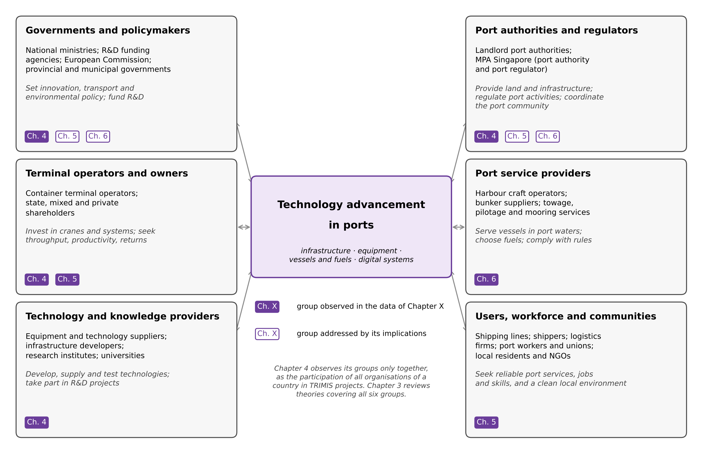

> *Comment 6 (verbatim): "The term 'stakeholder(s)' are used throughout the thesis. It is connected with many different expression: for example, stakeholder 'activities' (p. 98), 'participation' (p. 100), 'engagement' (p. 111), 'interests' (p.129), 'management' (129), 'behavior' (p. 153), 'collaboration', 'coordination' (p. 184), etc. However, the thesis has not defined who stakeholder(s) is (are). If the stakeholders are grouped such as government policy-maker, terminal operator, port authority, etc., each group's interests, management, participation, behavior, and others are different!"*
>
> *What the examiner's page numbers refer to (old PDF, located in the 10 Oct text): p. 98 "activities" is the H3 paragraph in Section 4.3.2 ("aggregate of all stakeholder activities"); p. 100 "participation" is the screening sentence in Section 4.3.3 ("those lacking stakeholder participation, such as academic-only consortia"); p. 111 "engagement" is in Sections 4.4.3 to 4.6 ("aggregate stakeholder engagement", "promoting stakeholder engagement"); p. 129 "interests" and "management" is the sentence on Notteboom et al. (2015) in Section 5.2; p. 153 "behavior" is the theory list in Section 6.1 ("stakeholder behaviour"); p. 184 "collaboration" and "coordination" is the Chapter 3 summary in Section 7.1.1.*
>
> *Structure of this file. Part A adds the stakeholder subsection to Section 1.5, as you asked: 1.5.1 defines the term, reviews how the port literature groups stakeholders and sets out six groups with their roles and interests (Table 9, Figure 5); 1.5.2 replaces the current "From a practical standpoint…" paragraph with the practical significance of each study for the groups it concerns (Table 10). Part B states, for Chapters 2 to 6, who the stakeholders are (one short paragraph per chapter, with its insertion point) and gives a table of every occurrence of "stakeholder(s)" with the action (keep, clarify or replace) and the revised text. Part C does the same for Chapter 7 and gives revised sentences for 7.1.1, 7.1.2, 7.2, 7.3 and 7.4. Part D is the response letter. The tables cover all 111 occurrences of the term in the text of the 10 Oct version (the remaining five are in the table of contents and in reference titles).*
>
> *Main decisions. (1) "Stakeholder" is kept where it is used in the sense of stakeholder theory (mainly Chapter 3) or where it reports a source's own term, and its meaning is now stated. Everywhere else the specific group is named. (2) In Chapter 4, "stakeholders" are defined as the organisations located in each sample country that lead or take part in the TRIMIS technology projects, using the organisation types the thesis itself lists in Section 4.3.1 (infrastructure operators, infrastructure developers, equipment suppliers, technology providers, research institutions, public bodies such as local authorities). Because participation is aggregated by country, the revised text says that the results do not distinguish between types of organisation and adds this as a limitation. In most Chapter 4 sentences "stakeholders" becomes "organisations"; the construct names follow file 06 (TDL in the general model, TIC in the port model) and file 05 (PT). (3) Chapter 7 now addresses each implication to the group and the context that the relevant chapter actually studied. Two attributions in the current Chapter 7 are corrected: Section 7.3 applies the container terminal findings to port authorities, and Section 7.1.2 asks MPA to expand R&D tax incentives, which are set by the government (Ministry of Finance Singapore, 2023).*
>
> *Numbering. Section numbers follow file 09 (Section 1.3 with 1.3.1 to 1.3.7, where 1.3.7 is "Empirical contexts") and the Chapter 7 renumbering used in the drafts (7.2 cross-study synthesis, 7.3 contributions, 7.4 limitations). Files 01 and 08 still refer to the empirical contexts as "Section 1.4"; please change those cross-references to "Section 1.3.7". File 09 adds Tables 1 to 7 and Figures 1 to 3 before the existing Table 1 and Figure 1, so the new table and figure in Section 1.5 are numbered Table 9, Table 10 and Figure 5 here; Word caption fields will renumber the later tables automatically. Sentences drafted in files 06 and 08 that still say "stakeholder participation" or "stakeholder activities" are superseded by the wording in Parts B and C below. Notes to you are in grey italic boxes. Everything else in Parts A to C is proposed thesis text, to be marked purple; the response in Part D is in green.*

# A. CHAPTER 1, SECTION 1.5: PORT STAKEHOLDERS AND RESEARCH SIGNIFICANCE

> *Keep the heading "1.5 Research significance", its opening paragraph (with the two phrase edits in Table A4, rows 1.5) and the paragraph on academic contributions, which starts "From an academic perspective…" and needs no change. Then insert the two new subsections below. Section 1.5.2 replaces the paragraph that begins "From a practical standpoint, the findings provide actionable implications for policymakers…". The final paragraph of Section 1.5 ("Overall, the significance of this research…", as revised in file 01, Part A3) moves to the end of Section 1.5.2, with the last sentence revised as shown there.*

## 1.5.1 Port stakeholders

Throughout this thesis, the actors that develop, adopt, finance, regulate or are affected by port technologies are referred to as stakeholders. Because these actors differ in their roles and interests, this section defines the term, identifies the main groups of port stakeholders and their interests in port technology, and specifies which groups each study concerns. Section 1.5.2 then sets out the practical significance of each study for those groups.

In strategic management, a stakeholder in an organisation is "any group or individual who can affect or is affected by the achievement of the organization's objectives" (Freeman, 1984/2010, p. 46). Stakeholder theory also recognises that stakeholders do not receive equal attention from managers. Their salience depends on their power to influence the organisation, the legitimacy of their relationship with it and the urgency of their claims (Mitchell et al., 1997). Applying the definition to ports requires one further step, because a port is not a single organisation. It is a cluster of public and private organisations, including the port authority, terminal operators, providers of port services and other port-related firms (de Langen, 2004), and its management, operation and development involve many decision-makers, from port authorities and terminal operators to rail operators, trucking companies, logistics providers and port cities (Notteboom et al., 2022). These organisations influence port development but pursue different goals, so conflicts of interest between them are a recurring feature of port governance (de Langen, 2006). In this thesis, a port stakeholder is therefore defined as any organisation, group or individual that can affect, or is affected by, the development, adoption or use of technology in a port. The organisation whose objectives are at stake differs between the studies: the port in general in Chapter 3, the organisations that lead or take part in technology projects in Chapter 4, the container terminal operator in Chapter 5 and the operator of the harbour craft studied in Chapter 6.

The port literature groups stakeholders in several ways. From the perspective of the port authority, Notteboom et al. (2022) distinguish three core groups: business-related stakeholders, such as shipping lines, shippers, terminal operators, logistics and forwarding companies and transport service providers; institutional stakeholders, which deal with the port authority on policy, regulation, legislation and the public interest; and societal groups and local communities, which seek port growth with minimal externalities. Port authorities themselves combine several functions, as landlord, regulator, operator and community manager (Verhoeven, 2010), and the division of tasks between the port authority, government and private operators depends on the port management model (World Bank, 2007; Section 1.3.2). Government acts at several levels, from national ministries to regional and municipal authorities, which may also need to coordinate competing ports within a region (Lam et al., 2013). The innovation systems literature adds the organisations that create and diffuse knowledge. A national innovation system comprises government, industry, universities and the research environment (Godin, 2009), and port authorities can act as leaders of regional innovation networks (Cahoon et al., 2013) or as builders of technological innovation systems, such as that for offshore wind (Sornn-Friese et al., 2023). The importance of each group is not fixed. Which stakeholders are included in port planning has changed over time (Dooms et al., 2013), and port managing bodies give different priority to different groups; a study of the green strategies of Italian port management bodies, for example, identified terminal operators and local communities as their primary stakeholder groups (Satta et al., 2024).

Drawing on these classifications, this thesis distinguishes six groups of port stakeholders according to their role in port technology advancement (Table 9 and Figure 5). The grouping is a synthesis made for the purpose of this thesis rather than a classification proposed by any single source. The first group comprises governments and policymakers: the national ministries and agencies that set innovation, transport and environmental policy and fund R&D through budget allocations, grants and tax incentives; supranational bodies such as the European Commission, which funds transport research and innovation projects (European Commission, 2023b); and regional and municipal governments, which in China administer ports within a framework of national policy guidance (Notteboom & Yang, 2017). Their interests lie in national competitiveness, economic growth and the achievement of policy targets such as decarbonisation. The second group consists of port authorities, which administer, develop and manage the port's land and basic infrastructure and regulate activities in the port (Section 1.3.2), and of maritime regulators. As landlords, port authorities also manage their relations with key stakeholders, for example through the information they disclose (Notteboom et al., 2015). In some ports, the roles of port authority and regulator are combined in one body. In Singapore, for example, MPA acts as port authority, port regulator and port planner (MPA Singapore, n.d.-b); it licenses harbour craft and sets the conditions under which licensed bunker suppliers may supply biofuel in the port (MPA Singapore, n.d.-a, 2022b). Port authorities seek the competitiveness of the port as a whole, the efficient use of scarce land and infrastructure, and acceptance by the local community (Notteboom et al., 2022; Verhoeven, 2010).

The third group comprises terminal operators and their owners. Under the landlord model, terminal operators lease terminals from the port authority and provide and operate their superstructure and equipment (World Bank, 2007; Section 1.3.4), so they make most decisions on investment in cargo-handling technology, and their owners, which may be state, mixed or private, shape the objectives of these decisions. The fourth group consists of port service providers, which provide services to vessels such as towage, mooring, pilotage and bunkering (Regulation (EU) 2017/352). It includes harbour craft operators and bunker suppliers. Terminal operators and port service providers are mainly concerned with productivity, cost, the return on investment and compliance with regulation. The fifth group consists of technology and knowledge providers, namely equipment and technology suppliers, infrastructure developers and contractors, research institutes and universities, which develop, supply and test new technologies, often jointly with operators in R&D projects. The sixth group comprises port users, the port workforce and local communities. Port users, such as shipping lines, shippers and logistics firms, are concerned with the reliability, speed and cost of port services; port workers and their unions with employment and working conditions (Turnbull & Wass, 2007), which technological change such as automation can affect (Notteboom & Haralambides, 2020); and local residents and non-governmental organisations with the congestion and environmental externalities of port activities (Notteboom et al., 2022).

These groups differ not only in their interests but also in the way they take part in technology advancement. Governments and port authorities shape the conditions for technology adoption through policy, funding, concessions and regulation; terminal operators and port service providers decide whether to invest in and use particular technologies; technology and knowledge providers develop and supply them; and port users, workers and local communities experience their effects. Interests can also differ within a group, for example between national and local governments or between state-owned and private terminal operators. The thesis therefore names the specific group whenever a statement concerns only that group, and uses "stakeholders" without qualification only when referring to stakeholder theory or to the groups collectively. It should also be noted that the empirical studies do not survey the perceptions or behaviour of the stakeholder groups. Each study observes particular groups through the data available at its level of analysis, as summarised in Table 10 (Section 1.5.2), and a finding obtained for one group in one context, such as Chinese container terminal operators, is not attributed to another group or context.

Table 9: Port stakeholder groups, their roles and interests in port technology, and the studies concerned

| Group | Examples | Main role and interests in port technology | Studies concerned |
|--------------------|---------------------------|----------------------------|-------------------------|
| Governments and policymakers | National ministries; R&D funding agencies; European Commission; provincial and municipal governments | Set innovation, transport and environmental policy; fund R&D; seek competitiveness and policy targets such as decarbonisation | Ch. 3; Ch. 4 (R&D incentives); Ch. 5 (port reform context); Ch. 6 (decarbonisation policy) |
| Port authorities and regulators | Landlord port authorities; MPA Singapore (port authority and port regulator) | Provide land and basic infrastructure; regulate port activities; coordinate the port community; seek port competitiveness and community acceptance | Ch. 3; Ch. 4 (among project participants); Ch. 5 (governance context); Ch. 6 (MPA as regulator) |
| Terminal operators and their owners | Container terminal operators; state, mixed and private shareholders | Invest in and operate cargo-handling equipment and systems; seek throughput, productivity and returns | Ch. 3; Ch. 4 (among project participants); Ch. 5 (unit of analysis) |
| Port service providers | Harbour craft operators; bunker suppliers; towage, pilotage and mooring services | Serve vessels in port waters; choose fuels; seek low cost and compliance | Ch. 3; Ch. 6 |
| Technology and knowledge providers | Equipment and technology suppliers; infrastructure developers; research institutes; universities | Develop, supply and test technologies; take part in R&D projects | Ch. 3; Ch. 4 (among project participants) |
| Port users, workforce and local communities | Shipping lines; shippers; logistics firms; port workers and unions; residents; NGOs | Reliable, low-cost services (users); jobs, skills and working conditions (workers); limited externalities (communities) | Ch. 3; Ch. 5 (workforce education); Ch. 6 (local air pollutants, indirectly) |

Sources: Freeman (1984/2010); Mitchell et al. (1997); de Langen (2004, 2006); Verhoeven (2010); World Bank (2007); Notteboom et al. (2022); Godin (2009); MPA Singapore (n.d.-b); Regulation (EU) 2017/352; Turnbull and Wass (2007); Chapters 3 to 6 of this thesis.

{width=100%}

> *Please check three points. (1) The Chapter 4 entries "among project participants" for port authorities and terminal operators (Table 9 and the filled Ch. 4 tags in Figure 5) assume that the port technology projects include port authorities and terminal operators among their participants, under your category "transport infrastructure operators". If your project list shows otherwise, delete those two entries and change the tags in the figure script (scratchpad/scripts10/fig_stakeholders.py), and I will redraw it. (2) Freeman's definition is quoted with p. 46, the page given in the secondary sources I found; please check it in your copy (the 2010 Cambridge reissue reproduces the 1984 text). (3) Freeman (2010, Cambridge University Press) and Mitchell et al. (1997, Academy of Management Review) fall outside the preferred publishers, but they are the original sources of the definition and of the salience concept.*

## 1.5.2 Practical significance of each study for its stakeholders

Because the studies observe different stakeholder groups in different countries, their practical significance is set out here for the groups concerned and within the context of each study (Table 10).

Study 1 (Chapter 3) reviews the theories used to explain port technology development. Its practical significance is mainly for researchers, who can use it to select theoretical foundations for different aspects of port technology, and indirectly for all six stakeholder groups, because it identifies the theories that explain the relations among them. Stakeholder and principal–agent theories, for example, explain the relations between governments or port authorities and port enterprises over technology investment and benefit sharing, and innovation system theories explain how port authorities can coordinate the development of new technologies (Section 3.4.3; Cahoon et al., 2013; Sornn-Friese et al., 2023). As a review, the chapter does not test these relationships.

Study 2 (Chapter 4) concerns the organisations located in 35 European countries that lead or take part as partners in technology-related transport infrastructure projects recorded in TRIMIS, such as infrastructure operators, infrastructure developers, equipment suppliers, technology providers, research institutions and public bodies (Section 4.3.1). Their participation is measured for each country as a whole. The chapter shows that government incentives for R&D and national innovation input are associated with a higher national technology development level, which is in turn associated with a higher level of participation; in the port model, government incentives and a favourable R&D environment are associated with a higher technological innovation capacity, which is associated with greater participation in port technology projects. The findings are therefore of most direct relevance to national governments and R&D funding agencies in European countries, which set the incentives. They suggest that government incentives are associated with participation mainly indirectly, through the technology development level, which indicates that incentives matter for participation chiefly to the extent that they support technological development in the country. For the participating organisations themselves, the findings describe the national conditions under which the organisations of a country participate more in technology projects. Because participation is aggregated by country, however, they do not show how each type of organisation, such as a port authority, a terminal operator or a research institute, decides whether to participate.

Study 3 (Chapter 5) concerns 46 container terminal operators in China, observed from 2015 to 2021. Their workforce and owners enter the analysis as attributes of the operators: the share of employees holding a bachelor's degree or above, and the ownership structure, from state to mixed and private ownership. For container terminal operators, the finding that the number and capacity of quay cranes and yard gantry cranes increase with the previous year's throughput supports forward-looking capacity planning, and the association between workforce education and technological progress suggests that investment in education and training may support technological progress. For the owners of terminal operators, and for the municipal and provincial governments responsible for port reform in China, the finding that greater private participation in ownership is associated with faster technological progress over time is relevant to decisions on ownership structure. Shipping lines, shippers and other port users are affected by terminal performance but are not analysed. These relationships are associations observed for Chinese terminals during a period of throughput growth (Section 7.2.3).

Study 4 (Chapter 6) concerns the use of biofuel in harbour craft in the Port of Singapore. Its data come from sea trials of a harbour craft, and the groups directly concerned are harbour craft operators, licensed bunker suppliers and MPA in its roles as port authority and regulator. For harbour craft operators, the machine-learning models provide tools for predicting fuel consumption and emissions, and the finding that B100 increases fuel consumption by about 5.66 per cent compared with marine gas oil is relevant to cost planning. For MPA, which requires all new harbour craft operating in the port from 2030 to be fully electric, capable of using B100 biofuel or compatible with net-zero fuels (MPA Singapore, 2024b), the trade-off between lower CO₂ and CO emissions and higher NOₓ emissions informs the design of requirements and of possible complementary NOₓ measures. The classification of blending ratios offers MPA and bunker suppliers a screening tool for checking that the blend used on board matches the blend supplied. Engine manufacturers and local communities are indirectly concerned by the NOₓ results but are not examined.

Table 10: Stakeholders concerned by each study

| Study | Stakeholders observed in the data | Stakeholders addressed by the implications | Boundary of the findings |
|--------------|------------------------------|------------------------------|--------------------------|
| Study 1 (Ch. 3) | Actors examined in the reviewed studies (all six groups) | Researchers; all groups, through the choice of theory | Review; relationships not tested |
| Study 2 (Ch. 4) | Organisations in 35 European countries leading or joining TRIMIS technology projects, aggregated by country; governments as providers of R&D incentives | National governments and R&D funding agencies; participating organisations, e.g., operators, suppliers, research institutes | European countries; country-level associations; types of organisation not distinguished |
| Study 3 (Ch. 5) | 46 Chinese container terminal operators; workforce education and ownership as attributes | Terminal operators and their owners; governments responsible for port reform in China | Chinese container terminals, 2015–2021; associations |
| Study 4 (Ch. 6) | A harbour craft in sea trials, Port of Singapore | Harbour craft operators; licensed bunker suppliers; MPA as port authority and regulator | One vessel, operating setting and biofuel; recalibration needed elsewhere |

Sources: Chapters 3 to 6 of this thesis.

> *The final paragraph of Section 1.5 (file 01, Part A3) follows here. Replace its last sentence, "This approach advances academic understanding while offering stakeholders practical, context-sensitive guidance on port technology development in an era of global trade and decarbonisation.", with the sentence below.*

This approach advances academic understanding while offering national policymakers, terminal operators, harbour craft operators, and port authorities and regulators practical, context-sensitive guidance on port technology development in an era of global trade and decarbonisation.

## Other occurrences in the Summary and Chapter 1

> *Action: Keep = no change; Clarify = keep the term or the sentence but make the group or meaning explicit; Replace = name the specific group or reword. Each "Current text" cell quotes only the phrase that changes.*

| Location | Current text | Action | Revised text |
|------------------|------------------------------------|---------|-------------------------------------|
| Summary, Chapter 4 paragraph | "…the association between national innovation capability and stakeholders' participation in the port development projects." | Replace | "…the association between national innovation conditions and the participation of each country's organisations in transport and port technology projects." |
| Summary, last paragraph | "…practical implications for stakeholders such as policymakers, port authorities, and terminal operators…" | Clarify | "…practical implications for specific stakeholder groups: national policymakers and R&D funding agencies (Chapter 4), container terminal operators and their owners (Chapter 5), and harbour craft operators, bunker suppliers and the port authority and regulator (Chapter 6)…" |
| 1.1, first paragraph | "…reshaping the logistics performance and stakeholder interactions (Jefroy et al., 2022; Maddikunta et al., 2022)." | Keep | — (general statement reported from the sources) |
| 1.1, last paragraph | "…actionable insights for policymakers and industry stakeholders." | Replace | "…insights for policymakers, port authorities, terminal operators and harbour craft operators." |
| 1.2, Objective 2 | "…to examine the technological factors related to stakeholder participation in port development projects…" | Replace | "…to examine the technology-related factors associated with the participation of a country's organisations in transport and port technology projects (Section 1.5.1)…" |
| 1.3, "Research scope" (old text) | "…government incentives, and stakeholder participation are related to the extent which technology projects are initiated…" | Replace | Paragraph replaced by Section 1.3.6 (file 09), which already uses "the participation of a country's organisations in technology projects". |
| 1.4, second stage | "…examined the technology-related determinants of stakeholder participation in technology projects…" | Replace | "…examined the technology-related factors associated with the participation of organisations in technology projects…" |
| 1.5, opening paragraph, gap (2) | "…between technology-related factors and stakeholder participation in port infrastructure projects;" | Replace | "…between technology-related factors and the participation of organisations in port infrastructure technology projects;" |
| 1.5, opening paragraph | "…at the national level (stakeholder participation)…" | Replace | "…at the national level (participation of organisations in technology projects)…" |
| 1.5, academic paragraph | "…organisational readiness, stakeholder theory, and socio-technical transition perspectives." | Keep | — (name of a theory) |
| 1.5, practical paragraph (three occurrences) | "…industry stakeholders such as terminal operators…"; "…relates to the stakeholder participation…"; "…stakeholder-specific guidance…" | Replace | Paragraph replaced by Section 1.5.2. |
| 1.5, final paragraph (two occurrences) | "…factors affecting stakeholder participation in technology projects…"; "…practical value to stakeholders navigating…" | Replace | Paragraph replaced by file 01, Part A3, with the last sentence revised as above. |
| 1.6, Chapter 4 | "Chapter 4 examines the factors associating with stakeholder participation in transport infrastructure projects to develop technology level, with a specific discussion on port infrastructure development. It focuses on how factors… shape willingness to participate…" | Replace | "Chapter 4 examines, for European countries, how government incentives, innovation input and the technology development level are associated with the participation of each country's organisations in transport infrastructure technology projects, with a specific analysis of port technology projects. It focuses on the national conditions associated with a higher level of participation." |

# B. CHAPTERS 2 TO 6: WHO THE STAKEHOLDERS ARE, AND REVISED WORDING

## B1. Chapter 2

> *Chapter 2 does not need its own statement of who the stakeholders are, because it reviews concepts and points forward to Section 1.5.1. Six occurrences, in Sections 2.2, 2.3 and 2.4.*

| Location | Current text | Action | Revised text |
|------------------|------------------------------------|---------|-------------------------------------|
| 2.2 | "…stakeholders usually have multiple concerns when considering developing technologies… (Short & Kopp, 2005)." | Clarify | "…the public and private organisations involved usually have multiple concerns when considering developing technologies… (Short & Kopp, 2005)." |
| 2.2 | "…when stakeholders participate in transport infrastructure projects." | Replace | "…when public and private organisations participate in transport infrastructure projects." |
| 2.2 | "Developing transport infrastructure also involves various stakeholders, which increases the system's sophistication." | Clarify | "Developing transport infrastructure also involves many public and private organisations, such as public authorities, infrastructure operators, contractors and technology suppliers (Section 1.5.1), which increases the complexity of the system." |
| 2.2 | "…involving a diverse mix of stakeholders and disciplines at various stages… (Steininger et al., 2024)." | Keep | — (reports the source) |
| 2.3 | "…many attempts by port stakeholders, especially port operators and port authorities, to apply the new technologies…" | Replace | "…many attempts by port authorities and terminal operators to apply the new technologies…" |
| 2.4, closing paragraph | "By integrating analyses of stakeholder participation, equipment deployment, and sustainable operations…" | Replace | "By integrating analyses of the participation of organisations in technology projects, equipment deployment and sustainable operations…" |

## B2. Chapter 3

> *Insert the paragraph below at the start of Section 3.4.3, before "While organisational and institutional theories addressed…". In Chapter 3 the generic term is correct, because the chapter reviews stakeholder theory, so most occurrences are kept; the paragraph makes their meaning explicit.*

In this review, the term stakeholder is used in the sense of stakeholder theory, in which a stakeholder is any group or individual who can affect or is affected by the achievement of an organisation's objectives (Freeman, 1984/2010). In the port studies reviewed, the stakeholders concerned are mainly port authorities, terminal and other port operators, governments and regulators, port users such as shipping lines, shippers and logistics firms, technology providers, port workers and local communities. Section 1.5.1 groups these actors and summarises their roles and interests. Because the reviewed studies concern different groups, the group concerned is named where a finding refers to a specific group.

| Location | Current text | Action | Revised text |
|------------------|------------------------------------|---------|-------------------------------------|
| 3.1 | "…the need to cope with stakeholder concerns, such as labour displacement and cybersecurity (Notteboom & Haralambides, 2020)." | Clarify | "…the need to address the concerns of specific groups, such as port workers facing labour displacement, and cybersecurity risks to port and terminal operations (Notteboom & Haralambides, 2020)." |
| 3.1 | "…actionable insights for researchers, policymakers, and industry stakeholders." | Replace | "…insights for researchers, policymakers, port authorities and port operators." |
| 3.3 | "…how far it should go are always challenges for port stakeholders." | Replace | "…how far it should go are recurring strategic questions for port authorities and terminal operators, which make most technology investment decisions in ports (Section 1.3.5)." |
| 3.4 (introduction) | "…stakeholder, network and system theories…" | Keep | — (category of theories) |
| 3.4.1 | "…to tailor implementation strategies for different stakeholder groups (Alamoush, 2024; Wagner, 2023)." | Keep | — (reports the sources) |
| 3.4.1 | "…the sequential stages of knowledge, persuasion, decision, implementation, and confirmation, stakeholders follow when adopting port innovativeness (Roso et al., 2019)." | Replace | "…the sequential stages of knowledge, persuasion, decision, implementation and confirmation that adopting organisations follow when deciding on an innovation, as applied to the adoption of the dry port concept (Roso et al., 2019)." |
| 3.4.1 | "…supporting policymakers and stakeholders in addressing transboundary governance challenges effectively." | Clarify | "…supporting policymakers and other actors in the cross-border region in addressing transboundary governance challenges." |
| 3.4.3, heading | "Stakeholders, network and system Theories" | Keep | — (optional: "Stakeholder, network and system theories") |
| 3.4.3 | "…could be more detailed captured by stakeholders related theories." | Keep | — (optional: "stakeholder-related theories") |
| 3.4.3 | "…the Stakeholder Theory emphasises the importance of engaging diverse actors, such as port authorities, operators, and regulators…" | Keep | — (groups already named) |
| 3.4.3 | "Stakeholder theory in port technology development looks into the role of policymakers and industry practitioners…" | Keep | — (groups already named) |
| 3.4.3 | "…while addressing stakeholder perspectives… (Guo & Zeng, 2024)." | Keep | — (reports the source) |
| 3.4.3 | "…conflicts that may arise between stakeholders such as port operators (agents) and authorities (principals)…" | Clarify | "…conflicts that may arise between governments (principals) and port enterprises such as terminal operators (agents)…" (Sun et al., 2023, study a government incentive contract for port enterprises) |
| 3.4.3 (two occurrences) | "…theories studying the role of stakeholder and actors, analyse the structural and relational patterns that connect stakeholders within the port ecosystem…" | Clarify | "…theories studying the roles of stakeholders and other actors, analyse the structural and relational patterns that connect port authorities, operators, users and other actors within the port ecosystem…" |
| 3.4.3 | "…relationships and interactions highlighted stakeholder and network theories…" | Keep | — (names of theories) |
| 3.4.4 | "It describes competitive dynamics between port stakeholders and other parties, such as early adopters…" | Replace | "It describes the strategic interactions between port operators and other parties, for example the advantages gained by early adopters of innovations such as blockchain and the promotion of shore power technology through government subsidies (Le et al., 2023; Li et al., 2020)." |
| 3.4.5 | "…the focus on sustainability, digitalisation, and stakeholder collaboration." | Keep | — (element of the concept in Lee et al., 2025) |
| 3.4.5 | "…catering to multifaceted business needs and various community stakeholders' requirements." | Keep | — (term of the customer-centric community port concept, Lee & Lam, 2016) |
| Table 7 (two occurrences) | "Stakeholders, Network and System Theories"; "Stakeholder Theory / Principal-Agent Theory" | Keep | — (names of theories; groups already named in the last column) |
| 3.5 | "Stakeholder collaboration is equally crucial, as seen in blockchain-enabled cargo tracking, where cooperation between shippers, customs, and terminal operators…" | Keep | — (groups named) |
| Table 8, Adoption and Diffusion | "Technology uptake depends on stakeholder readiness…" | Replace | "Technology uptake depends on the readiness of adopting organisations and users…" |
| Table 8, row heading | "Stakeholders, Network and System" | Keep | — (category of theories) |
| Table 8, Industry 4.0 row | "…sustainability and stakeholder collaboration provide the direction…" | Clarify | "…sustainability and collaboration among port authorities, operators and users provide the direction…" |
| 3.6 (two occurrences) | "…practical contributions for industry stakeholders. Port policymakers can utilise insights from Institutional Theory and Stakeholder Theory…" | Replace / Keep | "…practical contributions for policymakers, port authorities and port operators. Policymakers and port authorities can utilise insights from Institutional Theory and Stakeholder Theory…" |

> *In the same Section 3.6 paragraph, the sentence "the success of Singapore's Smart Port initiative is largely driven by institutional support and collaborative engagement with logistics companies and technology providers" has no citation. It is outside this comment, but an examiner may ask for a source; an MPA release on its port innovation programmes would do.*

## B3. Chapter 4

> *Chapter 4 is where the undefined term matters most, because its dependent construct is "the level of participation". Five changes are proposed. (a) One sentence in Section 4.1. (b) A new definition at the start of "Level of participation" in Section 4.3.1, which states who participates, how participation is counted and what the construct does not measure. (c) The matching definition in Section 4.5.2 for the port model. (d) A sentence in Section 4.4.3 and a new limitation in Section 4.6. (e) The table of all occurrences. The organisation types are those your text already lists in Section 4.3.1, in the participation paragraph ("transport infrastructure operators, equipment suppliers, technology providers, infrastructure developers and local authorities") and in the technology development level paragraph ("research institutions, public agencies"); I have not added any type that the thesis does not mention. I confirmed through the TRIMIS overview document (trimis.ec.europa.eu, "TRIMIS general", January 2024) that each project record lists the participating organisations together with the timeframe, funding source, budget and EU contribution; I could not confirm that TRIMIS classifies organisations by type, so the text does not say so.*

### (a) Section 4.1, last paragraph

> *Replace the sentence "Stakeholder participation refers to the involvement of organisations as project leaders or project partners in technology-related infrastructure projects, which will be introduced in detail in later content."*

In this chapter, stakeholder participation refers to the involvement of the organisations located in a country as lead organisations or partners in the technology-related transport infrastructure projects recorded in TRIMIS; Section 4.3.1 defines these organisations and explains how their participation is measured.

### (b) Section 4.3.1, "Level of participation": new opening paragraphs

> *Replace the first paragraph under "Level of participation" (from "According to the literature and database, the participation level…" to "…they utilise the funding to complete the project.") with the two paragraphs below. The next paragraph then begins "The participation level of the organisations in each sample country is reflected by three aspects:" (this replaces "…in each European Union country…", as file 08 also suggests). The bracketed clause needs your confirmation.*

In this chapter, the level of participation in transport infrastructure technology development is defined as the extent to which the organisations located in a particular country participate in technology-related transport infrastructure projects. These organisations are the stakeholders whose participation is measured. The projects are retrieved from the Transport Research and Innovation Monitoring and Information System (TRIMIS), which records for each project the participating organisations together with its timeframe, funding source, budget and, where applicable, EU contribution (European Commission, 2023b). Each project is carried out by a lead organisation with several partners. Participation means that an organisation has been a contributing party to a project, providing resources, services or skills to complete it, with funding from the European Commission or a European national government. The participating organisations are of several types: transport infrastructure operators, infrastructure developers, equipment suppliers, technology providers, research institutions and public bodies such as local authorities [; in the port projects, the infrastructure operators include port authorities and terminal operators]. The technology projects examined encompass both hardware-focused initiatives (e.g., new crane systems, alternative fuel infrastructure, automated terminal equipment) and software-focused initiatives (e.g., port community systems, digital platforms, remote control interfaces).

Two features of this definition are important for interpreting the results. First, participation is measured for all the organisations of a country together, whatever their type, by aggregating the projects in which they take part. The level of participation is therefore a country-level construct. It describes how strongly the organisations of a country, taken together, are involved in technology projects, but it does not distinguish between types of organisation or describe the decisions of individual organisations (Section 4.3.2). Second, governments enter the model in a different role. Although public bodies can be project partners, national governments are represented in the model mainly as providers of R&D incentives, which are measured separately, from national statistics, by the construct of government incentives for R&D. The European Commission and the national governments that fund the projects are likewise treated as funders rather than as participants.

### (c) Section 4.5.2: definition of participation in the port model

> *Replace "The level of participation in port technology is defined as: in a certain country, the extent that the organisations are willing to be involved in the port projects with technology development attributes." The indicators measure actual involvement, so "willing" is removed. The list of the three indicators that follows stays as it is.*

The level of participation in port technology projects is defined as the extent to which the organisations located in a country are involved in port projects with technology development attributes. As in the general model, these organisations are the lead organisations and partners of the port technology projects recorded in TRIMIS [, such as port authorities, terminal operators, equipment and technology suppliers and research institutes], and their participation is aggregated by country.

### (d) Sections 4.4.3 and 4.6

> *Section 4.4.3: add the sentence below after "…they may take into account the three technology-related factors investigated in this chapter to support their decision-making." (that sentence itself is revised in the table).*

Because the level of participation is a country-level aggregate, these implications concern the national conditions under which organisations participate in technology projects, rather than evidence on the decisions of individual organisations.

> *Section 4.6, limitations: insert after the new limitation on project cost (file 05, Part E).*

In addition, the participation construct aggregates all the participating organisations of a country and does not distinguish between their types. Infrastructure operators, equipment and technology suppliers, research institutions and public bodies take part in technology projects for different reasons and with different resources (Section 1.5.1), so the associations estimated here describe the participation of a country's organisations as a whole and may differ between types of organisation. The results should therefore not be read as describing the decisions of any particular type of organisation. Future research could classify the participants by type, for example into public bodies, private companies, research organisations and higher education institutions, and examine whether the relationships differ between them.

> *For the future-research sentence: for projects funded by the EU Framework Programmes, the Commission's CORDIS records classify participants by activity type (higher or secondary education, research organisations, private for-profit entities, public bodies, other). I found this only through secondary descriptions, so I have not cited it in the thesis text; it may help if you extend the analysis.*

### (e) All occurrences in Chapter 4

| Location | Current text | Action | Revised text |
|------------------|------------------------------------|---------|-------------------------------------|
| Chapter title (and table of contents) | "TECHNOLOGY-RELATED FACTORS ON STAKEHOLDER PARTICIPATION IN PORT DEVELOPMENT PROJECTS: A STRUCTURE MODEL ANALYSIS" | Replace | "TECHNOLOGY-RELATED FACTORS AND THE PARTICIPATION OF ORGANISATIONS IN TRANSPORT AND PORT TECHNOLOGY PROJECTS: A STRUCTURAL EQUATION MODEL ANALYSIS" (the table of contents and the body currently give different titles) |
| Chapter introduction | "This chapter explores the technology-related factor' association with stakeholder participation in transport infrastructure projects first…" | Replace | "This chapter first examines how technology-related factors are associated with the participation of a country's organisations in transport infrastructure technology projects, and then…" |
| Chapter introduction | "…are related to stakeholders' level of participation in the technology development initiatives." | Replace | "…are related to the level of participation of these organisations in technology development projects." (supersedes file 06, B1) |
| 4.1, second paragraph | "…the willingness and capacity of diverse stakeholders, such as governments, private investors, contractors, and operators…" | Keep | — (groups named) |
| 4.1, third paragraph | "…stakeholders usually have multiple concerns when considering developing technologies…" | Replace | "…the organisations involved usually have multiple concerns when considering developing technologies…" |
| 4.1, last paragraph | "…the technology-related factors associated with stakeholder participation in transport infrastructure technology development in European region…" | Replace | "…the technology-related factors associated with the participation of organisations in transport infrastructure technology projects in European countries…" |
| 4.1, last paragraph | "Stakeholder participation refers to the involvement of organisations…" | Clarify | See (a) above. |
| 4.3.1, Level of participation (four occurrences) | "…the extent to which the stakeholders participate…"; "The participating stakeholders include…"; "Participation means the stakeholder has been…"; "The aforementioned stakeholders receive funding…" | Replace | See (b) above. |
| 4.3.1, second paragraph | "…the participation level is reflected to be higher if the stakeholders in the country have a higher degree of commitment…" | Replace | "…the participation level is higher if the organisations in the country, taken together, show a higher degree of commitment, resource allocation and technical capability." |
| 4.3.1, project cost | "…including project cost as a proxy for stakeholder participation level…" | Replace | "…including project cost as an indicator of the level of participation…" |
| 4.3.1, project cost | "In practice, stakeholders who choose to participate in costly infrastructure technology projects…" | Replace | "In practice, organisations that choose to participate in costly infrastructure technology projects…" |
| 4.3.1, project cost | "Empirically, in the study on stakeholders' willingness to take risk in port PPP, Xiao & Lam (2020)…" | Replace | "Empirically, in their study of the willingness to take contractual risk in port public–private partnerships, Xiao and Lam (2020)…" |
| 4.3.1, project cost | "…is hypothesised to encourage stakeholders to engage in larger-scale, higher-cost infrastructure projects…" | Replace | "…is hypothesised to encourage organisations to engage in larger-scale, higher-cost infrastructure projects…" |
| 4.3.1, project cost | "…the capability, confidence, and willingness of stakeholders to take part…" | Replace | "…the capability, confidence and willingness of the participating organisations to take part…" |
| 4.3.1, project duration | "…the higher the risk the stakeholders will bear…" | Replace | "…the higher the risk the participating organisations will bear…" |
| 4.3.2, structural framework | "…a robust theoretical justification for stakeholders' involvement in transport infrastructure technology projects…" | Replace | "…a theoretical justification for the involvement of firms and other organisations in transport infrastructure technology projects…" |
| 4.3.2, structural framework | "…analysis of national-level factors on stakeholder participation…" | Replace | "…analysis of the national-level factors associated with the participation of organisations…" |
| 4.3.2, H3 paragraph (p. 98 "activities") | "…measured at the country level as the aggregate of all stakeholder activities (total leading projects, total duration, total project costs) within that country." | Replace | "…measured at the country level as the aggregate of the activities of all participating organisations located in that country (total projects led, total duration, total project cost)." (supersedes file 06, B3) |
| 4.3.2, H3 paragraph (p. 111 "engagement") | "…tend to exhibit higher aggregate stakeholder engagement in technology projects." | Replace | "…tend to show a higher aggregate participation of their organisations in technology projects." (supersedes file 06, B3) |
| 4.3.3, screening (p. 100 "participation") | "…and those lacking stakeholder participation, such as academic-only consortia." | Replace | "…and projects carried out only by universities and research institutes, without the participation of operators, suppliers or public bodies." |
| 4.4.3, two-stage pathway | "…attracting stakeholders facing long-term investments." | Replace | "…which may make such projects more attractive to organisations that must commit resources over long periods." |
| 4.4.3, practical implications | "For the stakeholders participating in the transport infrastructure development projects, several key managerial implications are drawn from the results. When the stakeholders consider whether to take part…" | Replace | "For the organisations that participate in transport infrastructure technology projects, such as infrastructure operators, equipment and technology suppliers and research institutes, several managerial implications can be drawn. When these organisations consider whether to take part…" (followed by the new sentence in (d)) |
| 4.4.3, practical implications | "Therefore, the stakeholders' activities are also impactful in developing technologies in transport infrastructure." | Replace | "The activities of these organisations therefore also matter for the development of transport infrastructure technologies." |
| 4.4.3, practical implications | "The stakeholders in the transport infrastructure markets, such as investors, suppliers, operators, etc, are encouraged to actively communicate with the government…" | Replace | "Infrastructure operators, equipment and technology suppliers and investors are therefore encouraged to communicate actively with government agencies…" |
| 4.5, introduction | "…great interest for the stakeholders such as port authorities, terminal operators and investors…" | Keep | — (groups named) |
| 4.5.2, port model | "…the extent that the organisations are willing to be involved in the port projects…" | Clarify | See (c) above. |
| 4.5.3, port doctrines | "…important foundations for encouraging stakeholders to engage in port infrastructure technology projects." | Replace | "…important foundations for encouraging organisations in European countries to take part in port infrastructure technology projects." |
| 4.6, contributions | "…a novel theoretical lens for understanding stakeholder participation in those capital intensive projects." | Replace | "…a theoretical lens for understanding the participation of a country's organisations in capital-intensive technology projects." |
| 4.6, transferability | "…actionable policy and managerial insights into promoting stakeholder engagement in transport infrastructure technology projects…" | Replace | "…policy and managerial insights into promoting the participation of organisations in transport infrastructure technology projects…" |

## B4. Chapter 5

> *Insert the paragraph below in Section 5.3.2, directly after the two paragraphs on the Chinese institutional context added by file 08 (Part A3). If you move those paragraphs to Section 5.1, put this paragraph at the end of Section 5.1 instead.*

The stakeholders concerned by this chapter can be specified accordingly. The unit of analysis is the container terminal operator, the company that operates a terminal and decides on its cargo-handling equipment (Section 1.3.4). Two other groups enter the analysis only as attributes of the operators: the workforce, through the percentage of employees holding a bachelor's degree or above, and the owners, through the ownership structure of the operator, which ranges from state to mixed and private ownership. The municipal and provincial governments, port groups and national ministries that shape port governance in China form the common context described above and are not modelled. Shipping lines, shippers and other port users are affected by terminal performance but are not analysed. The implications in Section 5.5 are therefore addressed to container terminal operators and their owners, and to the governments responsible for port reform in China.

| Location | Current text | Action | Revised text |
|------------------|------------------------------------|---------|-------------------------------------|
| Chapter introduction | "…offering valuable implications for both academia and industry stakeholders in the maritime sector to improve container terminal performance." | Replace | "…offering implications for researchers and for container terminal operators, their owners and the authorities that oversee them." |
| 5.1, first paragraph | "…various strategies are applied by container terminal stakeholders to improve terminal performance…" | Replace | "…various strategies are applied by container terminal operators and port authorities to improve terminal performance…" |
| 5.2 (p. 129 "management") | "…Notteboom et al. (2015) applied stakeholder management principles in a longitudinal framework…" | Keep | — (reports the source) |
| 5.2 (p. 129 "interests") | "…to investigate how these tools manage stakeholder interests over time." | Clarify | "…to investigate how the port authority used disclosure to manage its relations with its key stakeholders over time." |
| 5.5, equipment deployment | "…port operators could prioritise forward-looking throughput monitoring…" | Replace | "…terminal operators could prioritise forward-looking throughput monitoring…" |
| 5.5, equipment deployment | "…policymakers may focus coordination measures, such as berth/yard land allocation, grid upgrades…" | Replace | "…port authorities and municipal governments may focus coordination measures, such as the allocation of berth and yard land, grid upgrades…" |
| 5.5, technology progress | "Container terminal management could consider promoting privatisation or public-private partnerships…" | Replace | "The owners of container terminal operators, and the governments responsible for port reform in China, could consider privatisation or public–private partnerships…" |
| 5.6, contributions | "…it provides a reference to stakeholders such as terminal operators to implement better strategies…" | Replace | "…it provides a reference for container terminal operators and their owners to implement better strategies…" |
| 5.6, contributions | "…providing a reference for policymakers aiming to foster technological innovation and efficiency." | Clarify | "…providing a reference for policymakers in China considering further reform of the ownership of terminal operators." |

> *The rows on Section 5.5 and on the last 5.6 sentence do not contain the word "stakeholder", but they use vague or inconsistent group names ("port operators" for terminal operators, "policymakers" for the bodies that allocate port land), which the examiner's comment also covers. Please check that "percentage of employees holding a bachelor's degree or above" matches your variable definition; it is taken from your Section 5.4.2.*

## B5. Chapter 6

> *Insert the paragraph below at the end of Section 6.1, after the paragraph that ends "…as an operational-level case of sustainable port technology development." and before Section 6.2. Section 6.3 indicates that the trials used one vessel (vessel design parameters "remain constant for a given vessel"), so the text says "the harbour craft examined in the sea trials".*

The stakeholders concerned by this chapter are those involved in the use of biofuel in harbour craft in the Port of Singapore. Harbour craft operators run the vessels and decide on their fuels and operating profiles, and the data describe the operation of a harbour craft in sea trials (Section 6.3); harbour craft operators are therefore the group whose operations are observed. Two further groups are directly concerned by the results. Licensed bunker suppliers deliver biofuel blends in the port under conditions set by MPA (MPA Singapore, 2022b), and MPA, as port authority and port regulator, licenses harbour craft and sets the decarbonisation requirements for them (MPA Singapore, n.d.-a, n.d.-b, 2024b). Engine manufacturers, suppliers of exhaust after-treatment systems and local communities exposed to air pollutants in port waters are indirectly concerned by the NOₓ results, but they are not examined. The implications in Section 6.4 are addressed to these groups in the Singapore context.

| Location | Current text | Action | Revised text |
|------------------|------------------------------------|---------|-------------------------------------|
| Chapter introduction | "…from the perspectives of investment (stakeholder participation in technology projects) and landside productivity…" | Replace | "…from the perspectives of investment (the participation of organisations in technology projects) and terminal productivity on the land side of the port…" (the second part follows file 09, Part B) |
| 6.1, theory list (p. 153 "behaviour") | "…interacts with regulatory frameworks, operational practices, and stakeholder behaviour." | Replace | "…interacts with the regulatory framework set by MPA, the operating practices of harbour craft operators and the supply practices of bunker suppliers." |
| 6.4, first paragraph | "…practical implications for maritime stakeholders, particularly policymakers, port and vessel operators, and regulatory authorities." | Replace | "…practical implications for harbour craft operators, bunker suppliers, MPA as port authority and regulator, and policymakers responsible for maritime decarbonisation." |
| 6.4, blending ratio | "By collecting ship-operational data and exhaust data, the stakeholders could verify whether the biofuel used on board is consistent with the given information by the fuel provider…" | Replace | "By collecting operational and exhaust data, MPA as regulator, and harbour craft operators as buyers of the fuel, could verify whether the biofuel used on board is consistent with the information given by the bunker supplier, and bunker suppliers could use the same tool in their own quality assurance…" |
| 6.4, NOₓ trade-off | "Stakeholders should therefore consider emissions management strategy…" | Replace | "Harbour craft operators, and the port authorities and regulators that set emission requirements, should therefore consider their emissions management strategy…" |
| 6.4, last paragraph | "…offers practical solutions for multiple stakeholders. For vessel operators, … For policymakers and regulators, …" | Replace | "…offers practical tools for harbour craft operators, bunker suppliers and regulators. For harbour craft operators, … For policymakers and regulators such as MPA, …" |
| 6.5, contribution 2 | "…an operational reference to stakeholders such as maritime authorities and operators…" | Replace | "…an operational reference for harbour craft operators and for maritime and port authorities such as MPA…" |
| 6.5, contribution 3 | "This is significant for stakeholders such as bunker suppliers and vessel operators…" | Replace | "This is significant for bunker suppliers, harbour craft operators and MPA as regulator…" |

# C. CHAPTER 7: GROUP-SPECIFIC AND CONTEXT-SPECIFIC IMPLICATIONS

> *Every implication in Chapter 7 now names the group, and the chapter and country in which the evidence was obtained, consistent with Section 1.5.1 and Table 10. The new text is given in full where a paragraph changes substantially (C1 to C5); single-phrase changes are in the table in C6. The revisions build on file 06 (TDL), file 08 (Parts B1 to B3) and file 09 (land side and water side).*

## C1. Section 7.1.1: Chapter 3 summary and Chapter 4 findings

> *(i) In the Chapter 3 summary paragraph, apply the three phrase edits in C6. (ii) Replace the numbered heading "1) Role of technology-related factors in promoting stakeholder participation in technology projects:" and the next three paragraphs (from "Chapter 4 carried out empirical analysis…" to "…the transport infrastructure and port technology level.") with the heading and paragraphs below. "Promoting" is removed from the heading because the results are associations. The phrase "which helps to mitigate the stakeholders' concerns and encourages participation in such projects" is removed because the chapter did not observe either effect.*

1) Technology-related factors and the participation of organisations in technology projects

Chapter 4 examined, for 35 European countries, how technology-related factors are associated with the participation of each country's organisations, such as infrastructure operators, equipment and technology suppliers, research institutions and public bodies, in the transport infrastructure technology projects recorded in TRIMIS. Drawing on national innovation system theory and the demand-pull and technology-push framework, it investigated the relationships between three national factors, namely government incentives for R&D, national innovation input and the technology development level, and the level of participation, measured for each country as the aggregate number of projects led, duration of participation and project cost of all its participating organisations.

The findings show that the national technology development level has a direct positive relationship with the level of participation and mediates the associations of innovation input and government incentives with participation. Higher government incentives and innovation input are associated with a higher technology development level, which is in turn associated with a higher level of participation. This is consistent with the view that a higher development level makes technology projects more feasible and less risky for the organisations that take part in them, although the country-level data do not allow this mechanism to be observed directly. Government incentives and innovation input are also strongly associated with each other, which suggests that incentives may support the absorptive capacity and technological readiness on which participation draws.

The analysis of port technology projects indicates that government incentives for R&D and a favourable R&D environment are positively associated with a country's technological innovation capacity, which is in turn positively associated with the participation of the country's organisations in port technology projects. These results provide evidence for national policymakers and R&D funding agencies in European countries on the conditions associated with higher participation, and contextual information for the organisations that take part in such projects, such as port authorities, terminal operators and technology suppliers. Because participation is aggregated by country, they do not show how each type of organisation decides whether to participate.

> *Section 7.1.1, Chapter 5 summary: in the last sentence, replace "…offering valuable implications for both academia and industry stakeholders in the maritime sector to improve container terminal performance." with "…offering implications for researchers and for container terminal operators and their owners in China seeking to improve terminal performance."*

## C2. Section 7.1.2: implementation for Singapore

> *(i) After the qualification that file 08 (Part B3) adds to the first paragraph of Section 7.1.2, add the sentence below. (ii) Replace the paragraphs under "1) Implementation of findings at the national level (Chapter 4)" and "2) Implementation of findings at the terminal level (Chapter 5)" with the two paragraphs below. (iii) Replace the paragraph under "3) Implementation of sustainable operations findings (Chapter 6)" with the third paragraph below. Two factual points are corrected in (iii): the current text refers to "Singapore's target of 100% electric or biofuel-powered harbour craft by 2030 (MPA Singapore, 2025)", whereas the requirement is that new harbour craft from 2030 be fully electric, B100-capable or net-zero compatible (MPA Singapore, 2024b); and the Singapore Maritime Data Hub needs a source. I found that MPA developed SG-MDH as a maritime data repository around 2018, but only in news reports, so I have left a placeholder. In point (1), "MPA Singapore, 2021, 2025" are the citations your current text gives for the Maritime GreenFuture Fund; I could confirm the fund (set up by MPA with an initial S$40 million) only through trade press, so please check that one of those two MPA pages mentions it.*

Each application below is addressed to the Singapore stakeholder group responsible for the corresponding decision: the government and MPA for R&D policy, the terminal operators for equipment and workforce, and harbour craft operators, licensed bunker suppliers and MPA for the decarbonisation of harbour craft.

1) Implementation of findings at the national level (Chapter 4). The structural models show that, in European countries, government incentives, innovation input and the technology development level are together associated with the participation of a country's organisations in transport infrastructure technology projects. Whether the same relationships hold in Singapore would need to be tested with Singaporean data (Section 7.2.3). If they do, two Singapore stakeholders could draw on them: the government, which sets national R&D tax incentives such as the deductions for qualifying R&D expenditure under the Enterprise Innovation Scheme (Ministry of Finance Singapore, 2023), and MPA, which funds maritime R&D through schemes such as the Maritime GreenFuture Fund (MPA Singapore, 2021, 2025). They could (1) design incentives so that they raise the technology development level in maritime fields, since the European results suggest that incentives are associated with participation mainly through it; (2) encourage partnerships between research institutions, such as Nanyang Technological University and the National University of Singapore, and port operators, such as PSA Corporation and Jurong Port, to support knowledge spillovers and absorptive capacity; and (3) use the structural model, re-estimated with comparable data, as a diagnostic tool for comparing Singapore's innovation conditions with those of other countries.

2) Implementation of findings at the terminal level (Chapter 5). The growth models for Chinese container terminals show that crane deployment follows the previous year's throughput and that technological progress is associated with workforce education and with greater private participation in ownership. These relationships were estimated for Chinese terminals during a period of throughput growth, and container terminals in Singapore differ from that sample in land constraints, automation and ownership (Section 7.2.2). For Singapore's terminal operators, the results therefore suggest questions to examine with their own data rather than ready-made strategies: (1) whether crane capacity should be planned against expected throughput, supported by lifecycle cost–benefit analysis; (2) how investment in workforce upskilling in automation, digitalisation and data analytics relates to technological progress; and (3) how ownership and governance arrangements, including public–private partnerships, support long-term technological competitiveness. In this way, the methodology, rather than the coefficients estimated for China, can support investment planning for terminal productivity in Singapore.

3) Implementation of sustainable operations findings (Chapter 6). The machine-learning models developed with Singapore sea-trial data offer a data-driven toolkit for the decarbonisation of harbour craft, which applies directly to the Singapore context. First, harbour craft operators could deploy the prediction models to monitor the fuel consumption and emissions of their vessels in a timely way and to choose fuel blends and operating profiles accordingly. Second, MPA as regulator, and licensed bunker suppliers in their own quality assurance, could use the classification model to screen biofuel blending ratios, which supports transparency in biofuel supply and is relevant to the requirement that all new harbour craft operating in the Port of Singapore from 2030 be fully electric, capable of using B100 biofuel or compatible with net-zero fuels (MPA Singapore, 2024b). Third, MPA could integrate such predictive tools into its maritime data platforms, such as the Singapore Maritime Data Hub [source needed], to support policy evaluation, carbon pricing and compliance monitoring under frameworks such as the International Maritime Organization's GHG Strategy. The simulated comparison of biofuel blends with MGO also provides MPA and harbour craft operators with benchmarks of the advantages and trade-offs of biofuel. In this way, the modelling framework can support alternative-fuel trials, the monitoring of operational performance, the verification of fuel use and the refinement of decarbonisation policy for harbour craft, on the basis of measured operational evidence rather than assumptions or simulations alone.

> *In the paragraph "Beyond Singapore, the methodologies are designed to be replicable…", replace its last sentence with: "Future applications may include national policymakers in developing economies seeking to benchmark innovation conditions, terminal operators evaluating equipment investment strategies, and port authorities and regulators designing data-driven sustainability policies, provided that the models are re-estimated with local data." The FuelEU Maritime regulation is removed from point (3) because it does not apply to Singapore harbour craft; keep it if you prefer, but as an example from another jurisdiction.*

## C3. Section 7.2: cross-study synthesis

> *Section 7.2.1 (10 Oct text, "Links and shared key factors"): replace "…some key factors are observed to recur across the three studies, which can provide implications for the port authorities and terminal operators taking into account for strategy and decision making." with the sentence below. Section 7.2.3: one phrase edit in C6.*

Meanwhile, some key factors recur across the three studies, and they have implications for the stakeholder groups concerned by each study (Table 10): national policymakers and R&D funding agencies in Chapter 4, container terminal operators and their owners in Chapter 5, and harbour craft operators and MPA in Chapter 6.

## C4. Section 7.3 (old 7.2): practical and policy contributions

> *Replace the two paragraphs beginning "For its practical and policy contributions, first, this thesis could provide guidance for policymakers." and "It also provides implications for port authorities and terminal operators." with the paragraph below, and replace the final sentence of the section ("In sum, the thesis contributes theoretically…") with the second paragraph below. The current text says that "Port authorities and operators can use these insights" from the container terminal analysis, but Chapter 5 studied terminal operators, not port authorities, so that attribution is removed.*

For its practical and policy contributions, the thesis provides guidance that is specific to the stakeholder groups and contexts examined. First, for national policymakers and R&D funding agencies, the Chapter 4 findings for European countries indicate that government incentives for R&D, the national technology development level and a favourable R&D environment are associated with greater participation of a country's organisations in transport and port technology projects. Because the incentives are associated with participation mainly through the technology development level, their relevance to participation appears to lie chiefly in the technological development they support. Second, for container terminal operators and their owners, the Chapter 5 evidence from Chinese terminals shows that crane deployment follows throughput and that technological progress is associated with workforce education and with greater private participation in ownership. These results can inform equipment planning and training by operators, and decisions on ownership structure by the governments responsible for port reform in China. Third, for harbour craft operators, licensed bunker suppliers and MPA as port authority and regulator in Singapore, the Chapter 6 results quantify the trade-offs of biofuel blends and provide machine-learning tools for predicting fuel consumption and emissions and for screening blending ratios, which can support operational planning, the verification of fuel supply and the design of regulation for harbour craft. In each case, the findings apply most directly to the group and the context in which they were obtained, and their use for other groups or ports requires the adaptation discussed in Section 7.2.3.

In sum, the thesis contributes theoretically by integrating innovation and technology perspectives into port research, and practically by providing context-specific insights for national policymakers, terminal operators, harbour craft operators, and port authorities and regulators seeking to raise technological capability, improve terminal performance and advance sustainable port operations.

## C5. Section 7.4 (old 7.3): limitations and future research

> *(i) In the first numbered point, use the sentence below in place of the second sentence drafted in file 08 (Part B2), which still says "stakeholder participation". (ii) Replace the third numbered point ("Third, this research design primarily examined…") with the second paragraph below. (iii) Replace the last direction for future research ("Finally, integrating socio-technical transition perspectives…") with the third paragraph below.*

The structural models used to analyse the technology development level and the participation of organisations in technology projects are appropriate for testing the hypothesised relationships, but they identify associations rather than definitive causal effects.

Third, this research examined technology development from national, organisational and operational perspectives using secondary and operational data, and it did not survey the stakeholder groups themselves. Chapter 4 measures the participation of all the organisations of a country together, so it cannot show whether the associations it identifies differ between port authorities, terminal operators, equipment and technology suppliers, research institutions and public bodies, whose interests and motives differ (Section 1.5.1). Chapter 5 observes container terminal operators, with their workforce and owners entering only as attributes, and Chapter 6 observes the operation of a harbour craft; the perspectives of regulators, bunker suppliers, port users, port workers and local communities are discussed but not measured. Broader socio-technical dimensions of technology transitions, such as the interests and behaviour of these groups, the conflicts of interest between them (de Langen, 2006) and long-term policy dynamics, are therefore yet to be explored.

Finally, stakeholder-specific research could classify the organisations that take part in technology projects by type and estimate group-specific models, and could use surveys or interviews with port authorities, terminal operators, harbour craft operators, regulators, port workers and local communities to examine their interests and decisions. Integrating such evidence with socio-technical transition perspectives could shed light on the interactions among policy frameworks, the decisions of these groups and technological pathways in the long-term evolution of port development.

## C6. All occurrences in Chapter 7

| Location | Current text | Action | Revised text |
|------------------|------------------------------------|---------|-------------------------------------|
| 7.1.1, Chapter 3 summary | "…adoption and diffusion theories explain how innovations spread among port stakeholders…" | Replace | "…adoption and diffusion theories explain how innovations spread among adopting organisations and users in ports…" |
| 7.1.1, Chapter 3 summary | "(3) stakeholder, network, and system theories…" | Keep | — (category of theories) |
| 7.1.1, Chapter 3 summary (p. 184 "coordination") | "…showing how stakeholder coordination, actor networks, innovation systems…" | Replace | "…showing how coordination among port authorities, operators, regulators and users, actor networks, innovation systems…" |
| 7.1.1, Chapter 3 summary (p. 184 "collaboration") | "…sustainability, resilience, and stakeholder collaboration." | Clarify | "…sustainability, resilience and collaboration within the port community." |
| 7.1.1, heading 1) | "Role of technology-related factors in promoting stakeholder participation in technology projects" | Replace | See C1. |
| 7.1.1, Chapter 4 (three occurrences) | "…stakeholders' participation in technology projects, which helps to mitigate the stakeholders' concerns…"; "…the level of stakeholder participation in transport infrastructure technology development." | Replace | See C1. |
| 7.1.1, Chapter 4 findings (two occurrences) | "…has a direct positive relationship with stakeholder participation…"; "…ability to mitigate risk and improve feasibility to stakeholders." | Replace | See C1. |
| 7.1.1, Chapter 5 | "…offering valuable implications for both academia and industry stakeholders in the maritime sector…" | Replace | See the note at the end of C1. |
| 7.1.2, national level | "…collectively enhance stakeholder participation in transport infrastructure technology projects. For Singapore, MPA can adopt these insights by…" | Replace | See C2. |
| 7.2.3, Chapter 4 | "…relationships among government incentives, innovation input, and stakeholder participation could suggest a mechanism…" | Replace | "…relationships among government incentives, innovation input, the technology development level and the participation of organisations in technology projects suggest a mechanism…" |
| 7.3, final sentence | "…actionable insights for stakeholders seeking to enhance technological capability…" | Replace | See C4. |
| 7.4, first point | "The analyses of innovation capability and stakeholder participation using a the structural models…" | Replace | See C5 (i). |
| 7.4, third point | "…such as behavioural factors, stakeholder conflicts, or long-term policy dynamics…" | Replace | See C5 (ii). |
| 7.4, future research | "…the complex interactions among policy frameworks, stakeholder behaviour, and technological pathways…" | Replace | See C5 (iii). |

# D. RESPONSE TO EXAMINER 3

> *For the response letter, under Comment 6 in your initial plan. Page numbers will be added once the revised thesis is paginated. The response cites only sources that also appear in the revised thesis.*

**Comment 6 – Stakeholder(s) never defined**

Response: I thank the examiner for this important comment, and I agree that the thesis used the term "stakeholder(s)" throughout without defining who the stakeholders are. The term was also combined with many different expressions, such as activities, participation, engagement, interests, management, behaviour, collaboration and coordination, as if the stakeholders formed a single group. As the examiner rightly points out, government policymakers, port authorities, terminal operators and other groups have different interests and take part in port technology development in different ways, so the undefined term left it unclear to whom several findings and implications referred.

I have made three sets of changes. First, I have added a new Section 1.5.1, "Port stakeholders". It defines a stakeholder, following Freeman (1984/2010), as any group or individual who can affect or is affected by the achievement of an organisation's objectives, and notes that stakeholders differ in power, legitimacy and urgency (Mitchell et al., 1997). Drawing on the port literature (de Langen, 2006; Notteboom et al., 2022; Verhoeven, 2010; World Bank, 2007), it defines a port stakeholder as any organisation, group or individual that can affect, or is affected by, the development, adoption or use of technology in a port. It then distinguishes six groups: governments and policymakers; port authorities and regulators; terminal operators and their owners; port service providers such as harbour craft operators and bunker suppliers; technology and knowledge providers; and port users, the workforce and local communities. Their roles and interests are described in the text and summarised in Table 9 and Figure 5. The section also states that the empirical studies observe particular groups through their data rather than by surveying them. A new Section 1.5.2 then sets out the practical significance of each study for the specific groups it concerns (Table 10), replacing the previous general paragraph on practical implications.

Second, I have specified who the stakeholders are in each chapter and revised every vague use of the term. I reviewed all 111 occurrences in the text. Where the term referred to a specific group, the group is now named; where it is used in the sense of stakeholder theory, mainly in Chapter 3, it is kept and its meaning is stated at the start of Section 3.4.3. The most important clarification concerns Chapter 4. Section 4.3.1 now defines the stakeholders whose participation is measured as the organisations located in each sample country that lead or take part in the technology projects recorded in TRIMIS, namely infrastructure operators, infrastructure developers, equipment suppliers, technology providers, research institutions and public bodies. It explains that participation is aggregated by country and that governments appear in the model mainly as providers of R&D incentives rather than as participants. A new limitation in Section 4.6 acknowledges that the aggregate measure cannot show whether the relationships differ between types of organisation. In Chapter 5, a new paragraph in Section 5.3.2 explains that the unit of analysis is the container terminal operator, that the workforce and owners enter only as attributes (education and ownership structure), and that governments form the common context. In Chapter 6, a new paragraph at the end of Section 6.1 identifies harbour craft operators, licensed bunker suppliers and MPA, in its roles as port authority and regulator, as the groups concerned.

Regarding the instances the examiner lists, "stakeholder activities" (p. 98) and "stakeholder engagement" (p. 111) in Chapter 4 now refer to the activities and participation of all participating organisations located in a country. The screening criterion on p. 100 now specifies that projects carried out only by universities and research institutes were excluded. The sentence on "interests" and "management" (p. 129) reports Notteboom et al. (2015) and now states that it concerns the Port of Rotterdam Authority's relations with its key stakeholders. "Stakeholder behaviour" (p. 153) now names MPA, harbour craft operators and bunker suppliers. "Coordination" and "collaboration" (p. 184) now refer to port authorities, operators, regulators and users, and to the port community.

Third, I have revised Chapter 7 so that every implication names the group concerned and the context in which the evidence was obtained, consistently with Section 1.5.1. The Chapter 4 implications are addressed to national policymakers and R&D funding agencies in European countries, the Chapter 5 implications to Chinese container terminal operators, their owners and the governments responsible for port reform, and the Chapter 6 implications to harbour craft operators, bunker suppliers and MPA in Singapore. In doing so, I corrected two attributions: Section 7.3 had applied the container terminal findings to port authorities, and Section 7.1.2 had suggested that MPA expand R&D tax incentives, which are set by the government. The limitations in Section 7.4 now state that the thesis did not survey the stakeholder groups and that Chapter 4 aggregates the types of participating organisation, and the future research directions suggest stakeholder-specific analyses. The main changes are summarised below.

| Section | Change |
|------------------------------|----------------------------------------------------------------------|
| 1.5.1 (new), Table 9, Figure 5 | Definition of stakeholder and port stakeholder; six groups with their roles and interests |
| 1.5.2 (new), Table 10 | Practical significance of each study for the groups it concerns |
| Summary; 1.1; 1.2; 1.4; 1.6 | General references to stakeholders replaced by the specific groups |
| 2.2–2.4; 3.1–3.6 | Vague uses replaced; meaning of the term in stakeholder theory stated at the start of 3.4.3 |
| 4.1; 4.3.1; 4.5.2 | Stakeholders defined as the organisations participating in TRIMIS projects, aggregated by country |
| 4.3.2–4.6 | "Stakeholder" replaced by "organisations"; new limitation on the aggregate measure |
| 5.3.2; 5.5; 5.6 | Terminal operators, owners, workforce and governments distinguished |
| 6.1; 6.4; 6.5 | Harbour craft operators, bunker suppliers and MPA named |
| 7.1–7.4 | Group-specific and context-specific implications; corrected attributions; new limitation and future research |

# REFERENCES

> *New entries for the reference list (APA 7). † = already in your list. ‡ = a detail I could not confirm (stated after the entry). "(file 01)", "(file 08)" or "(file 09)" = also added by that draft, so do not add it twice. Citations that are kept unchanged inside revised sentences (e.g., Short & Kopp, 2005; Roso et al., 2019; Sun et al., 2023; Xiao & Lam, 2020) are already in your list and are not repeated here. Reference letters: file 09 cites the MPA harbour craft licensing page as "MPA Singapore (n.d.)"; with the new "Who we are" page it becomes (n.d.-a). File 01 cites the Decarbonisation Blueprint as "MPA Singapore (2022)"; with the new port marine circular it becomes (2022a).*
>
> *Errors noticed in your existing list: (1) Cahoon et al. (2013): the journal field reads "Journal of Transport Geography, Institutions and the Transformatio-n of Transport Nodes, 27, 66–75"; the special-issue title and the stray hyphen should be removed ("Journal of Transport Geography, 27, 66–75"). (2) Lam, Ng and Fu (2013) has no DOI; it is https://doi.org/10.1016/j.rtbm.2013.06.001 (confirmed from the WMU repository record), and the second author's initials are usually given as "Ng, A. K. Y.". (3) Hartley et al. (2021) contains the artefacts "&amp;" and "(world)". (4) The DOIs of Steininger et al. (2024) ("https://doi.org/10.1016/j.trd.2024") and Vantola et al. (2021) ("https://doi.org/10.1016/j.mar") are truncated. (5) Xu et al. (2024) contains stray hyphens ("o-perational", "Researc-h"). (6) Heikkilä et al. (2022) has no DOI.*

Cahoon, S., Pateman, H., & Chen, S.-L. (2013). Regional port authorities: Leading players in innovation networks? *Journal of Transport Geography, 27*, 66–75. https://doi.org/10.1016/j.jtrangeo.2012.06.015 † (journal field to be corrected, see note)

de Langen, P. W. (2004). Governance in seaport clusters. *Maritime Economics & Logistics, 6*(2), 141–156. https://doi.org/10.1057/palgrave.mel.9100100 (file 09)

de Langen, P. W. (2006). Stakeholders, conflicting interests and governance in port clusters. In M. R. Brooks & K. Cullinane (Eds.), *Devolution, port governance and port performance* (Research in Transportation Economics, Vol. 17, pp. 457–477). Elsevier. https://ideas.repec.org/a/eee/retrec/v17y2006i1p457-477.html ‡ (DOI not confirmed; please add it from ScienceDirect)

Dooms, M., Verbeke, A., & Haezendonck, E. (2013). Stakeholder management and path dependence in large-scale transport infrastructure development: The port of Antwerp case (1960–2010). *Journal of Transport Geography, 27*, 14–25. https://ideas.repec.org/a/eee/jotrge/v27y2013icp14-25.html ‡ (DOI not confirmed; please add it from ScienceDirect)

European Commission. (2023b). *Transport Research and Innovation Monitoring and Information System*. https://trimis.ec.europa.eu †

Freeman, R. E. (2010). *Strategic management: A stakeholder approach*. Cambridge University Press. https://doi.org/10.1017/CBO9781139192675 (Original work published 1984) ‡ (first published by Pitman, Boston; page 46 for the quoted definition is taken from secondary sources, so please check it in your copy)

Godin, B. (2009). National innovation system: The system approach in historical perspective. *Science, Technology, & Human Values, 34*(4), 476–501. https://doi.org/10.1177/0162243908329187 †

Lam, J. S. L., Ng, A. K. Y., & Fu, X. (2013). Stakeholder management for establishing sustainable regional port governance. *Research in Transportation Business & Management, 8*, 30–38. https://doi.org/10.1016/j.rtbm.2013.06.001 † (DOI to be added)

Ministry of Finance Singapore. (2023). *Enterprise Innovation Scheme* [Budget 2023 annex]. https://www.mof.gov.sg/docs/librariesprovider3/budget2023/download/pdf/fy2023_enterprise_innovation_scheme.pdf

Mitchell, R. K., Agle, B. R., & Wood, D. J. (1997). Toward a theory of stakeholder identification and salience: Defining the principle of who and what really counts. *Academy of Management Review, 22*(4), 853–886. https://doi.org/10.5465/amr.1997.9711022105

MPA Singapore. (n.d.-a). *Licensing of harbour craft and pleasure craft*. Maritime and Port Authority of Singapore. https://www.mpa.gov.sg/port-marine-ops/harbourcraft-and-pleasure-craft-regulations/licensing-of-harbour-craft-pleasure-craft (file 09, relettered)

MPA Singapore. (n.d.-b). *Who we are*. Maritime and Port Authority of Singapore. https://www.mpa.gov.sg/who-we-are

MPA Singapore. (2021). *Port of Singapore receives accolade for green port*. Maritime and Port Authority of Singapore. https://www.mpa.gov.sg/media-centre/details/port-of-singapore-receives-accolade-for-green-port †

MPA Singapore. (2022b, October 5). *Port Marine Circular No. 21 of 2022: Supply of biofuel within the Port of Singapore to vessels*. Maritime and Port Authority of Singapore. https://www.mpa.gov.sg/docs/mpalibraries/media-releases/2022/pmc-no-21-of-2022

MPA Singapore. (2024b, April). *Singapore gears up to meet net-zero needs of shipping* [Media release]. Maritime and Port Authority of Singapore. https://www.mpa.gov.sg/media-centre/details/singapore-gears-up-to-meet-net-zero-needs-of-shipping (file 01)

MPA Singapore. (2025). *Maritime Singapore Green Initiative*. Maritime and Port Authority of Singapore. https://www.mpa.gov.sg/maritime-singapore/sustainability/maritime-singapore-green-initiative/1000 †

Notteboom, T. E., & Haralambides, H. E. (2020). Port management and governance in a post-COVID-19 era: Quo vadis? *Maritime Economics & Logistics, 22*(3), 329–352. https://doi.org/10.1057/s41278-020-00162-7 †

Notteboom, T., Pallis, A., & Rodrigue, J.-P. (2022). *Port economics, management and policy*. Routledge. https://doi.org/10.4324/9780429318184 (file 09) ‡ (the three stakeholder groups are from Chapter 9.3, "Port marketing", and the list of decision-makers from the chapter on port reform and governance, both checked on the companion website, porteconomicsmanagement.org; please add page numbers from the book)

Notteboom, T., Parola, F., Satta, G., & Penco, L. (2015). Disclosure as a tool in stakeholder relations management: A longitudinal study on the Port of Rotterdam. *International Journal of Logistics Research and Applications, 18*(3), 228–250. https://doi.org/10.1080/13675567.2015.1027149 †

Notteboom, T., & Yang, Z. (2017). Port governance in China since 2004: Institutional layering and the growing impact of broader policies. *Research in Transportation Business & Management, 22*, 184–200. https://doi.org/10.1016/j.rtbm.2016.09.002 (file 01)

Regulation (EU) 2017/352 of the European Parliament and of the Council of 15 February 2017 establishing a framework for the provision of port services and common rules on the financial transparency of ports. *Official Journal of the European Union*, L 57. http://data.europa.eu/eli/reg/2017/352/oj (file 09)

Satta, G., Vitellaro, F., Njikatoufon, A. G., & Risitano, M. (2024). Green strategies in ports: A stakeholder management perspective. *Maritime Economics & Logistics*. https://doi.org/10.1057/s41278-024-00294-0 ‡ (volume, issue and pages not confirmed; the University of Genoa repository record lists only the first three authors, so please check the author list on the article page)

Sornn-Friese, H., Sofev, P., & Kondratenko, K. (2023). The port authority as system builder in cross-border regionalization: An exploratory study of port Esbjerg in the development of North Sea wind. *Maritime Transport Research, 4*, 100084. https://doi.org/10.1016/j.martra.2023.100084 †

Turnbull, P., & Wass, V. (2007). Defending dock workers—Globalization and labor relations in the world's ports. *Industrial Relations, 46*(3), 582–612. (file 01) ‡ (DOI not given in file 01)

Verhoeven, P. (2010). A review of port authority functions: Towards a renaissance? *Maritime Policy & Management, 37*(3), 247–270. https://doi.org/10.1080/03088831003700645 (file 09)

World Bank. (2007). *Port reform toolkit* (2nd ed.), Module 3: Alternative port management structures and ownership models. World Bank. https://ppiaf.org/sites/ppiaf.org/files/documents/toolkits/Portoolkit/Toolkit/module3/index.html (file 09)
